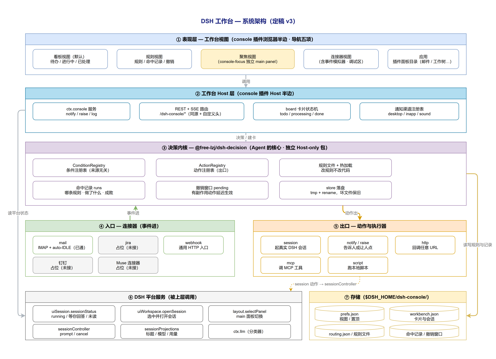
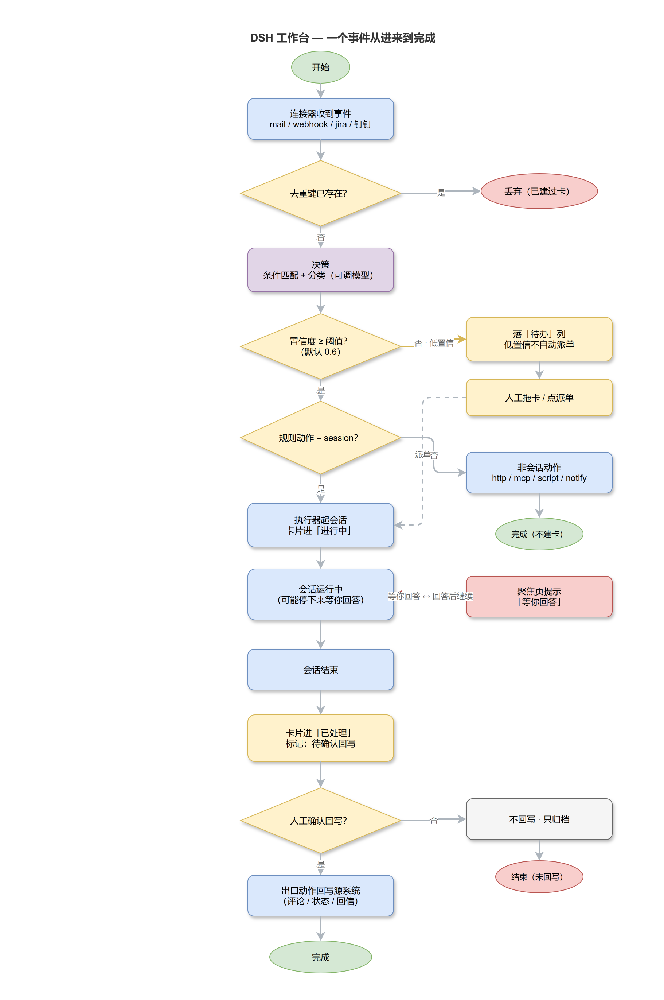

# 工作台改版：系统分析与方案（定稿 v3 · 2026-10-27）

状态：**分析定稿，13 项决策全部确认；P0 / P1b / P3 已实现并验证，P1a 完成 3/4，P2 受阻于宿主接口**。

### 实现状态（2026-10，`feature/workbench`）

| 期 | 状态 | 说明 |
|---|---|---|
| P0 页面骨架 | ✅ | 顶栏 + 五视图、注意力面板、看板重排、聚焦骨架、连接器/应用视图 |
| P1a 决策内核抽取 | 🟡 3/4 | `@free-lzj/dsh-decision`（规则读写、注册表、命中记录、撤销、配置归一）已抽出并有 51 条测试；最后一刀（通用动作 + 编排）卡在一个 payload 设计决定上，见下 |
| P1b 规则视图 | ✅ | 由邮件的分诊引擎提供数据；复制修改指令、原始文件、逐条试跑、条件值内联编辑 |
| P2 执行器真实化 | ❌ 受阻 | 文档设想的 `ctx.uiSession.sessionStatus` 在本版本宿主里不存在；建会话的入口（`agents.createSession`）属于 `SessionController` 插件内部对象，不是公开服务——见 [`docs/workbench-session-api.md`](../../workbench-session-api.md) |
| P3 LLM 分类器 + 规则编辑 | ✅ | 分类器真机验证（`classify-llm` 判据 + 人话解释）；规则页可改条件值（列表型），异构条件明确只读 |
| §9 必修 11 条 | ✅ | 去重竞态、重启僵尸卡、会话泄漏、回写出口、failed 死状态、全量轮询、失败静默、可访问性、文案硬编码、写放大、卸载清理 |

P1a 最后一刀待定的那一句话：邮件 payload 是否收敛成内核的 `EventPayload`（会再动一次 `runs.json` 形状），还是保留 `TEvent` 泛型、由连接器提供 `templateValues` 投影（不动数据形状）。倾向后者。

v3 修正三处：

- **决策内核归位** —— 这一层是 Agent 的核心（判断 → 决定 → 执行动作 → 留痕可撤），不是「分诊」。它属于工作台，邮件只是它的一个入口（§2）。这条推翻了 v2 的「连接器 + 执行器 + 分类器」三层划分，也否定了分支看板里那套与 mail `triage/` 重复的规则实现。
- **不自造会话状态** —— 「当前会话 / 未读」平台已经算好（`ctx.uiSession.sessionStatus`），见 §5.2。原设计里的未读水位与相关坑全部作废。

材料：`feature/workbench`（`3f8a675`）的看板 v0 实现、同分支的设计简报与 `prototype.html`、远程参考仓库 [luanyujia-workbench](https://github.com/mashanglinyu/luanyujia-workbench)、DSH 本机源码（`D:\open\deepseek-harness`）。

---

## 0. 结论摘要

「工作台页面太简陋」不是样式问题，是四件事同时缺：

1. **定位错位** —— 首页主体是「已接入插件目录」，接入的插件只有两三个、内容永远不变。没有信息增量，做得再漂亮也是空壳。
2. **层级缺失** —— 全页等权：header、注意力队列、插件卡用同一种 `settings-card` 材质；卡片只承载「标题 + 描述」，扫视时只能逐字读。
3. **数据空转** —— 决定这个页面价值的字段没接。分支的看板是模拟执行器 + 内存会话，从「没信息」变成「假信息」。
4. **能力放错地方** —— 完整可用的决策内核（条件→规则→动作、命中记录、撤销，约 4000 行）住在 `packages/mail` 里，而它本该是工作台的核心；分支又在 `console` 里重写了一套更弱的「分类器 + 路由表」。

改法：工作台变成**带视图导航的多视图页面**（看板 / 规则 / 聚焦 / 连接器）；决策内核上移并成为唯一的规则引擎；邮件降为连接器；「进行中 / 等你回答 / 跑完未读」直接用 `ctx.uiSession.sessionStatus`；接不上的显示为禁用 + 原因，不给假按钮。

---

## 0.5 架构与主流程（图）

**系统架构**（draw.io 源文件：[`workbench-architecture.xml`](../../images/src/workbench-architecture.xml)）



**一个事件从进来到完成**（draw.io 源文件：[`workbench-event-flow.xml`](../../images/src/workbench-event-flow.xml)）



---

## 1. 现状诊断

### 1.1 现有首页（`main`，console 0.2.x）

`header`（标题 + 搜索 + 布局切换 + 通知）→ 注意力队列 → 插件目录（grid / list / compact）。

| 区块 | 问题 |
|---|---|
| 插件目录 | 内容不变、数量少；三种布局是同一份数据的三种排法，切换不产生信息差 |
| 注意力队列 | 纯文本行 + Tag；无分组、无时间轴、无等待时长、无来源识别 |
| 运行中会话 | 只有 `title` + `cwd` 两行字；无状态、无最后活动、点不进去 |
| 全局 | 无统计、除搜索外无筛选、无空态引导、无键盘路径 |

### 1.2 分支看板 v0（`feature/workbench`）

**概念对，实现是演示。**

- 卡片 = 标题 + 一排文本 Tag。`body`、`priority`、`externalId`、`decision` 有数据零渲染。
- 缺统计条、缺列头/空态、缺卡片详情（时间线）、缺连接器开关与规则可视化。
- 会话聚焦是「按钮列表 + 纯文本 log」：无元信息、无时间戳着色、不自动滚底、无 `aria-live`；位置在三列下方。
- 数据全假：`SimulatedExecutor` 跑固定三步脚本；会话是 board 内存造的，与 DSH 真实会话、邮件、Jira 都没有连接。
- 位置问题：看板塞在插件目录**上面**，两块互不相干的内容争同一个滚动容器。

---

## 2. 四个概念必须先分清

设计简报里「连接器 = 入口 + 出口」。v1 把它和执行器混在一起，v3 再修正一次：**决策内核是独立的一层，而且它归工作台**。

这一层的名字值得说清楚——它不叫「分诊」。分诊只描述了「接进来判一下」，而它实际完成的是 Agent 的完整决策闭环：

```text
事件进来 → 判断这是什么（条件） → 决定怎么办（规则） → 去做（动作） → 留痕（命中记录） → 能撤回（撤销窗口）
```

判断、决定、执行、追溯，四件事都在这一层闭环，所以它是 **Agent 的核心**，不是某个功能的附属。命名定为 **决策内核 `@free-lzj/dsh-decision`**。

| 层 | 职责 | 本仓库现状 | 不是它 |
|---|---|---|---|
| **连接器** | 事件**进**（mail / jira / webhook / 钉钉 / Muse），动作**出**（回写评论、发通知、回信） | 只有元数据（`workbench/connectors.ts`），`out` 方向零实现 | 不是「数据源」，是双向管道 |
| **决策内核** | 判断 → 决定 → 执行动作 → 留痕 → 可撤；条件与动作都是注册表 | **住在 `packages/mail/src/triage/`（现名 triage），约 4000 行，完整可用** | 不是邮件专有功能，是工作台能力 |
| **执行器** | 接一张卡，起一个 agent 会话去干 | `SimulatedExecutor` 固定脚本 | 不是连接器；它是决策动作 `session` 的实现 |
| **分类器** | 判断这属于哪一类（可调模型） | 关键词打分 | 不是独立一层；它是决策内核的一个**条件**（`classifier`） |

### 2.1 关键事实：现在有两套决策实现

分支看板的 `classifier.ts` + `routing.ts` + `executors.ts`，和 mail 的 `triage/` 是同一件事的两套实现：

| 能力 | mail `triage/` | 分支 `workbench/` | 判定 |
|---|---|---|---|
| 判断这算什么 | 条件注册表（12 种，`conditions.ts`）+ `classifier` 条件 | 关键词打分（151 行） | mail 更完整 |
| 判断之后怎么办 | 规则文件 + 动作注册表（12 种，`actions/*`） | `routing.json` 路由表 + 4 个动作 | mail 更完整（有 `suggest` 三态） |
| 可扩展 | `ConditionRegistry` / `ActionRegistry` 按 kind 注册 | 三个注册表 | 两者都有 |
| 命中记录 | `runs.ts`（谁命中、做了什么、成功否） | `decision` 落卡 | mail 更完整 |
| 撤销 | `pending.ts` + 撤销窗口 | 无 | mail 独有 |
| 事件入口 | 只有 IMAP | 有 connector 元数据 + ingest | 各有一半 |
| 看板/卡片 | 无 | 有 | 分支独有 |

**结论：合并时以 mail 的注册表模型为准**（撤销、命中记录、suggest 三态是真实需要的），补上分支的连接器层与看板层，删掉分支那套关键词分类器与路由表。

### 2.2 决策内核归位：产品归属 vs 代码位置

用户已定「决策之后属于工作台，邮件只是一个入口」。要拆成两件事：

- **产品归属**：规则界面（规则列表、命中记录、撤销、预设）长在工作台，邮件面板里不再有自己的规则入口。
- **代码位置**：内核不该物理搬进 `console` 的 `src/`，因为 mail 需要 import 它，而 `console` 现在不依赖 mail。三种放法：

| 放法 | 结果 | 代价 |
|---|---|---|
| **A 搬进 `packages/console/src/decision/`** | mail 编译期依赖 console（方向可接受，无环） | console 再长 1500 行内核；第三个连接器进来时 console 承担全部重量 |
| **B 留在 `packages/mail`，console 反向 import** | —— | 方向错了，console 会为 jira/钉钉再复制一遍 |
| **C 抽 `@free-lzj/dsh-decision`（Host-only）** | console 和 mail 都依赖它；内核无来源概念 | 多一个包，多一条构建/发布线 |
| | **推荐 C** | |

推荐 C 的理由：连接器会越来越多（Jira / 钉钉 / webhook），内核单独立包后，新连接器只依赖内核、不依赖工作台；`console` 只负责界面与命中记录展示。这与 `rules/design-patterns.md` 的注册表写法和现有 `channels.ts` 的模式一致。

**量化依据（2026-10-27 实测）**：`triage/` 里**完全不出现邮件字段**的文件已有 1075 行 —— `registry` 81 + `store` 96 + `runs` 107 + `rules` 268 + `config` 390 + `pending` 133。再加上 `triage.ts`（编排，516 行）与 `types.ts`（393 行）里的通用部分，要搬的内核约 1500 行，远超「不值得单开包」的 1000 行门槛。**Q9 定案：抽 `@free-lzj/dsh-decision`。**

### 2.3 泛化点（迁移的真正工作量在这）

内核对邮件是**硬耦合**的，不是搬目录就能用：

| 现在 | 要变成 |
|---|---|
| `ActionTask.summary: MailSummaryLike` | `EventTask.payload: EventPayload`（来源 id + 通用字段 + 来源扩展） |
| `MatchContext.summary / accountName / body` | `EventContext.event / source / body` |
| 12 个邮件条件（发件人、主题、`List-Id`…） | 留在 mail，注册到内核的 `ConditionRegistry` |
| 9 个邮件动作（标已读、星标、移动、归档、`session`、`http`、`mcp`、`script`、`notify`） | 两类：**通用动作**（`session`/`http`/`mcp`/`script`/`notify`/`console.raise`）进内核；**邮件动作**留 mail |
| `MailLike` 的 IMAP 端口 | 留在 mail |

迁移后 mail 只剩：IMAP 收信 + 邮件条件 + 邮件动作 + 一个 adapter（`MailLike` → `EventPayload`）。

### 2.4 文件去向清单（P1a 照着搬，不再讨论）

| 现在（`packages/mail/src/triage/`） | 行数 | 去向 | 说明 |
|---|---|---|---|
| `registry.ts` | 81 | **内核** | 原样 |
| `rules.ts` | 268 | **内核** | 规则文件解析，与来源无关 |
| `runs.ts` | 107 | **内核** | 命中记录 |
| `pending.ts` | 133 | **内核** | 撤销窗口 |
| `store.ts` | 96 | **内核** | 落盘 |
| `config.ts` | 390 | **内核** | 字段校验；条件/动作 kind 改成由注册表提供，不再写死邮件那 12 个 |
| `types.ts` | 393 | **拆** | `Rule`/`Run`/`PendingAction` 进内核；`MailLike`/`MailSummaryLike` 留 mail |
| `triage.ts` | 516 | **拆** | 编排进内核；取正文那段留 mail |
| `mount.ts` | 640 | **拆** | 注册表装配进内核；IMAP、tools、设置页留 mail |
| `classify.ts` | 233 | **内核** | 分类通道本身通用，邮件只是它的输入 |
| `suggest.ts` | 70 | **内核** | 建议三态通用 |
| `conditions.ts` | 262 | mail | 12 种邮件条件，注册到内核 |
| `repo.ts` | 66 | mail | `List-Id` → 仓库名，纯邮件知识 |
| `actions/session.ts` `http.ts` `mcp.ts` `script.ts` `notify.ts` | 210+48+60+74+72 | **内核** | 与来源无关的出口动作 |
| `actions/flag.ts` `move.ts` `archive.ts` `mark-read.ts` `followup.ts` `context.ts` `index.ts` | 33+73+37+37+54+173+57 | mail | 邮件专有动作与端口 |
| 客户端规则界面 | — | **console** | 从 mail 顶栏搬到工作台「规则」视图 |

口径：内核约 **2100 行**（含 `triage.ts` 与 `types.ts` 的拆出部分），mail 留约 **1000 行**，console 新增规则 UI。

### 2.5 由此产生的边界调整

- 邮件面板的「规则」按钮消失，改由工作台「规则」视图承担；邮件面板只保留读邮件本身。
- 工作台的「规则」视图不再是 `routing.json` 一张表，而是决策的**规则文件 + 条件/动作注册表 + 命中记录 + 撤销**，与 mail 现有能力对齐。
- 「看板」与「规则」是同一条流水线的两端：决策产出的 `session` 动作 → 一张卡 + 一个执行器会话；决策产出的 `notify`/`console.raise` → 注意力队列。**看板不是独立系统，是决策结果的一个视图。**

---

## 3. 参考对象的取舍

### 3.1 原型（`prototype.html`）—— 抄信息架构，不抄视觉

| 原型元素 | 取舍 |
|---|---|
| 顶部四项统计 | **抄**，压成看板视图内的一行 |
| 三列 + 列头（色点 / 计数 / hint） | **抄** |
| 卡片解剖（来源 / 优先级 / 单号 / 描述 / 类型 / 置信度 / 执行器 / 状态 / 进度 / 耗时） | **抄**；其中**进度条与耗时是演示产物，真实数据没有**，改为「最后活动 / 已运行时长」 |
| 右侧会话聚焦 | **拆开**：跨会话的摘要留在看板右栏，深度视图另立（见 §5） |
| 卡片详情（分类 kv + 时间线 + 操作） | **抄**，DSH 无 Drawer 原语，用 `Modal` |
| 规则面板 | 并入「规则」视图，不在首页 |
| 事件模拟器 | 收进「连接器」视图的开发工具区 |
| 整套自定义色板（`#0e6e6b` 等）、圆角 6/8/10/14 | **不抄**。`rules/plugin-ui.md` 禁止颜色字面量与局部圆角数值 |

### 3.2 luanyujia-workbench —— 抄原则，不抄实现

那是「方法文档 + 壳模板 + 脱敏源码」，Electron + 原生 DOM + 零构建 + 17k 行单文件渲染器，实现不可搬。可用的是原则：

1. **看得见的落点**：状态写进标题行小字，不只写存储 → 卡片状态必须有文字，不能只靠色点。
2. **没有接口就不给假按钮** → 未接入的连接器/执行器显示禁用 + 原因。
3. **拖拽用 pointer events + `setPointerCapture`**，不用 HTML5 DnD（6px 阈值吞误触、支持触摸、webview 更稳）→ 借鉴。
4. **场景 = 一组常驻面板，各有独立上下文** → 工作台的「视图」可以这么长，但 v0 先固定几个。
5. **原位展开钉住**而非模态 → 只作为卡片详情的备选，首版用 `Modal`。

一条**不能**照搬的：它用 Electron `<webview>` 嵌整个 DSH 界面、按 `sessionId` 分区 pin。DSH 插件里没有等价能力（见 §5.3）。

---

## 4. 目标形态：顶栏 + 视图导航

用户已定：**工作台顶部是导航栏，样式跟对话页顶部的「对话 / 轨迹 / 上下文」一致。**

对话页那条 tab 条的实测规格（`ui-conversation/src/client/skeleton/ConversationRoot.module.css:193-238`）：

```css
.tabs      { display:flex; gap:36px; margin-top:10px; padding-left:8px }
.tab       { border:none; background:transparent; font-size:13px; line-height:16px; font-weight:500;
             color:var(--dsw-alias-label-tertiary) }
.tab::after{ height:2px; border-radius:2px; background:transparent }
.tabActive { color:var(--dsw-alias-state-business-primary) }
.tabActive::after { background:var(--dsw-alias-state-business-primary) }
```

```text
┌ 工作台 header（DSH 面板 header 几何：标题 + 右侧动作）────────────────┐
│ 工作台                                          [搜索]  [通知] [⋯]    │
├ 视图导航（同对话页 tab：13/16 · gap 36 · active 主色 + 2px 底条）──────┤
│ 看板      规则      聚焦      连接器      应用                          │
├─────────────────────────────────────────────────────────────────────┤
│  当前视图内容（工作台自持滚动容器）                                     │
└─────────────────────────────────────────────────────────────────────┘
```

五个视图，按使用频率排：

| 视图 | 回答什么 | 频率 | 备注 |
|---|---|---|---|
| **看板** | 现在有什么活、谁在干 | 最高（默认） | 决策结果的视图，不是独立系统（§2.5） |
| **规则** | 规则怎么配、昨天命中了什么 | 中 | 从 mail 顶栏搬来（§2.2） |
| **聚焦** | 当前会话 + 未读会话 | 高 | **独立 main panel**，点它是一次 `selectPanel`（§4.1） |
| **连接器** | 哪些入口通了、能往哪出 | 低 | 含事件模拟器（开发工具区） |
| **应用** | 打开接入的面板（邮件、工作树…） | 低 | 原「插件目录」，从折叠区升为一级导航（已定 2026-10-27） |

两个 panel（`console` / `console-focus`）共用同一份导航，选中态随当前 panel 变。

### 4.1 视图的注册方式（已定 2026-10-27：方案 C）

DSH 里「页面」= main 槽的一个 keyed entry，一次只渲染一个（`ui-layout/src/client/AppFrame.tsx:41-42`），且**没有 URL 路由**（`selectPanel` 是内存状态，`ui-layout` 里搜不到任何 persist/localStorage）。

| 方案 | 做法 | 代价 |
|---|---|---|
| **A 面板内切视图** | 全部视图在 `console` 一个 panel 里用状态切换 | 最简单；但「聚焦」不算独立页面，刷新即回看板 |
| **B 借会话页导航** | 「聚焦」注册成 `conversation.view`（先例：`ui-trajectory` 就是 `ctx.slots.register({ name:'conversation.view', order:10, label })`） | 天然与 对话/轨迹/上下文 并列、直接拿到会话上下文；但它属于会话页，不是工作台页面 |
| **C 两个 main panel** | `console`（工作台）+ `console-focus`（聚焦页），导航调 `ctx.layout.selectPanel` | 字面上实现「独立页面」；切面板会重挂载，且 layout 不持久化 → 当前视图要自己存进 prefs |

**已定（2026-10-27）**：选 **C** —— `console`（工作台）+ `console-focus`（聚焦页）两个 main panel，顶部导航调 `ctx.layout.selectPanel`；「当前视图」写进 `$DSH_HOME/dsh-console/prefs.json`（已有 `layout` 字段的先例）。

实现注意：

- 两个 panel 各自注册自己的顶栏导航，**视觉与状态必须一致**（同一份「当前视图」来源），否则从 `console-focus` 切回来会闪一下。
- `selectPanel` 对未注册的 key **会抛**（`ui-layout/src/client/service.ts:72-77`），切换前要判存在，且失败原因要显示出来（现有 `shell.tsx:170-201` 已经踩过这个坑，照抄那套处理）。
- 刷新后 layout 不恢复 → 启动时按 `prefs.currentView` 调一次 `selectPanel`。

### 4.2 视图导航的控件边界

对话页那条 tab 是**自绘 flex 页签**，不是共享原语。而 `rules/plugin-ui.md` 明令不得手写 `role="tablist"`（"这些 role 由 ui-primitives 拥有"）。

- 共享原语里可用的是 `SegmentedTabs`：有 `role=tablist` + 左右方向键/Home/End，但外观是**等宽 + 滑动指示器**，不是对话页的左对齐页签。
- 要 1:1 还原对话页外观，只能用纯 `Button` 组 + `aria-current`（不声明 tablist 语义），视觉对齐字号/颜色/底条。

**已定（2026-10-27）**：视觉 1:1 复刻对话页页签 —— 纯 `Button` 组 + `aria-current="page"`，**不声明 `role="tablist"` / `role="tab"`**（守住规则边界），选中态用 `--dsw-alias-state-business-primary` + 2px 底条，规格照抄 §4 上方那段 CSS。键盘走原生 Tab + Enter，不实现方向键切换（那是 tablist 的语义，声明了才该做）。

---

## 5. 「聚焦」页

### 5.1 定位（已定 2026-10-27）

用户已定：**聚焦页只列两类会话 —— 当前会话 + 未读会话**。不是完整会话列表，也不是重画会话 UI。

### 5.2 更正：这三样平台已经算好了，不要自造

v3 早前写过「DSH 里没有当前会话、没有 unread，要用 `mainView` + `asOfSeq` 自己合成水位」——那是只搜了 `unread` 这个词，没搜 `completionUnread`。实际 `ui-session` 已经有一份现成的统一状态，且**公开可订阅**：

```ts
// ui-session/src/client/index.ts:62-72, 299
export interface SessionStatus {
  readonly running: boolean | undefined
  readonly pendingInteraction: SessionPendingInteraction | undefined  // 正在等我回答的请求
  readonly completionUnread: boolean                                  // 跑完了但我没看过
}
ctx.uiSession.sessionStatus   // HostObservable<SessionStatusSnapshot>：getSnapshot + subscribe
```

它的内部实现恰好就是我原本打算自己算的那两条：

```ts
// ui-session/src/client/index.ts:517
private isMain(id) { return (this.sessions.list.getSnapshot().byId[id]?.retainedBy.mainView ?? 0) > 0 }
// :493-496  运行结束、且不在 main 里 → completionUnread
```

**结论**：工作台不自建未读水位，直接订阅 `ctx.uiSession.sessionStatus`。原 §5.3 那套「水位只能前进 / `mainView` 采样 vs 进入动作」的坑整个消失，**Q10 作废**。

### 5.3 页面内容：三类，不是两类

`SessionStatus` 比「当前 + 未读」多出一档，而且它最该置顶：

| 区块 | 数据 | 为什么排这个位置 |
|---|---|---|
| **等你回答** | `pendingInteraction !== undefined` | 会话卡在等我；不处理就一直停着 |
| **当前会话** | `running` 且在 main 里 | 回答「它正在干什么」 |
| **已结束 · 未读** | `completionUnread` | 跑完了我不知道，需要补一眼 |

用户定的「当前 + 未读」由后两块满足；「等你回答」是同一份数据里白拿的——它才是这个页面最该先说的。若 `uiSession` 没挂载（可选依赖），退化为只有「当前会话」一块，其余隐藏而不是显示空壳。

### 5.4 页面内容（布局）

```text
┌ 聚焦 ───────────────────────────────────────────────────────┐
│ 等你回答 (1)                                                 │
│ ┌──────────────────────────────────────────────────────────┐│
│ │ 会话标题 · 需要你确认：是否允许写入 D:\...\src ?           ││
│ │                              [ 去回答 ]  [ 进入会话 ]     ││
│ └──────────────────────────────────────────────────────────┘│
│ 当前会话                                                     │
│ ┌──────────────────────────────────────────────────────────┐│
│ │ 标题 · 执行器 · 运行中 · 已运行 12 分钟                    ││
│ │ 最近：定位到 FormSubmit.ts，正在写回归测试…                ││
│ │                     [ 插一句话 ] [ 进入会话 ] [ 更多 ]    ││
│ └──────────────────────────────────────────────────────────┘│
│ 已结束 · 未读 (3)                                            │
│ [ 标题 · 4 分钟前 ] [ 标题 · 1 小时前 ] [ 标题 · 昨天 ]       │
└──────────────────────────────────────────────────────────────┘
```

### 5.5 仍然做不到的

- **嵌完整会话视图**：会话 UI 是 session-scoped 槽位，只在会话页上下文里渲染，而且没有 per-session URL。
- **逐条已读**：只有会话级的 `completionUnread`，没有「读到第几条」。

### 5.6 更正：跳转到指定会话是**可以**的

v3 早前写「客户端 `ISessions` 没有 select，所以跳不到指定会话」——只查了 `ISessions`，漏了另一条服务。实际上：

```ts
ctx.uiWorkspace.openSession(target: SessionTarget): void
// "Select a Session and show its Conversation as one UI navigation action."
// ui-workspace/src/client/navigation.ts:44
```

`openSession` 是公开的客户端导航服务，`ui-schedule`、`ui-subagent`、`ui-workflow-run`、`ui-message-feedback`、`ui-chat` 都在用它。所以聚焦页的「进入会话」= `ctx.uiWorkspace.openSession(sessionId)`，**能精确打开第 N 个会话**，不需要退回「只回到对话页」。

工作台里按可选依赖注入（`uiWorkspace` 不在的部署只是少了这个按钮，不该起不来，同 `sessionController` 的处理方式）。

### 5.7 数据可得性（本机源码已核）

| 想要 | 能不能拿 | 出处 |
|---|---|---|
| 会话列表、标题、cwd、running | 能 | `sessionController.list()`（console 已用，`index.ts:172-183`） |
| 会话级 UI 状态：running / 等你回答 / 跑完未读 | 能 | `ctx.uiSession.sessionStatus`（可 `getSnapshot` + `subscribe`，见 §5.2） |
| 投影值（状态、模型、token、最后活动） | 能 | `ctx.sessionProjections.snapshot()/onChanged()`（`packages/api/session-controller/src/control.ts:22-30,62-75`） |
| 会话事件流（工具调用、assistant 输出） | 能，但要自己做摘要层 | `SessionEventStream` / `uiConversation` 事件注册 |
| 向会话插话 | 能 | `sessionController.prompt()` / `cancel()`（`session-controller/src/index.ts:462,514`） |
| **嵌入完整会话视图** | **不能** | 会话 UI 是 session-scoped 槽位，只在会话页上下文里渲染；也没有 per-session URL |

### 5.8 形态选择（已定 2026-10-27）

已选 **C：独立 main panel（`console-focus`）+ 摘要形态**（§4.1）。因此本页不做「假装嵌入」，也不做会话页 tab。

可选增强（不进 v0）：把「当前会话深度聚焦」另做一个 `conversation.view`，与 对话/轨迹/上下文 并列 —— 它能拿到完整会话上下文，深度可以做满。那是另一件事，不与本页冲突。

---

## 6. 看板视图

```text
待我决定 3 · 正在跑 2 · 今日完成 7 · 异常 1                    [筛选]
┌──────────────┬──────────────┬──────────────┬─────────────────┐
│ 待办 (3)      │ 进行中 (2)    │ 已处理 (7)    │ 聚焦（可选右栏） │
│  卡片…        │  卡片…        │  卡片…        │ 会话 A ▾        │
└──────────────┴──────────────┴──────────────┴─────────────────┘
```

### 6.1 状态条与注意力队列的重复问题（必须先定）

现在有两套「要我注意」的东西：

| 来源 | 内容 | 谁维护 |
|---|---|---|
| `console.notices` / `console.raise` | 插件举起的一条可点事项 | console 自己（内存 + 50 条上限） |
| `ctx.uiSession.sessionStatus` | 会话在等我回答 / 跑完未读 | ui-session |

两边都会出现「有个会话要你处理」，直接并排显示就是同一件事报两次。规则：

1. **状态条的数字是并集，按 `sessionId` 去重**：同一条会话既有 notice 又有 `pendingInteraction`，只算一次。
2. **回答动作不在这里做**：审批、提问的界面是会话页的 composer takeover（`ui-approval` / `ui-user-questions`）。工作台只显示「谁在等我、是什么」和一个「去回答」按钮（`ctx.uiWorkspace.openSession`），**不内嵌回答表单**——那是把会话页的 UI 复制一份，早晚不同步。
3. **`completionUnread` 不产生 notice**：它只是「跑完了你没看」，属于提示不属待办，只进聚焦页与状态条的「正在跑/今日完成」，不塞注意力队列。

一句话：**注意力队列只放「需要人做决定的事」，`completionUnread` 不算。**

- 宽屏 `minmax(0,1fr) / 340px`；<1080px 收起右栏（或整块移到下方）。
- 列头：状态点 + 名称 + 计数 + 一句 hint（「含低置信度兜底」「拖入即启动」「已回写出口」）+ 空态说明。
- 卡片详情走 `Modal`：分类结果、判断依据、流转时间线、动作。**时间线是「可追溯」的唯一落点**，缺它看板只是状态板。
- 键盘：`j/k` 选卡、`Enter` 开详情、`Esc` 关；拖拽必须有等价菜单路径（现在只有拖拽 = 不可访问）。

### 6.2 卡片解剖（映射到 DSH 原语）

| 行 | 内容 | 原语 / token |
|---|---|---|
| 1 | 来源（图标 + 名称）、外部单号 | `Tag tone="outline"` + `Icon*Regular`；单号 11/16 tertiary |
| 2 | 标题，最多 2 行 | 15/22，`label-primary` |
| 3 | 描述，最多 2 行 | 12/18，`label-tertiary`，`-webkit-line-clamp` |
| 4 | 类型、置信度、规则版本 | `Tag` + `Pill`：≥85 中性 / 60–85 warn / <60 error；版本 11/16 tertiary |
| 5（分隔） | 执行器、状态、最后活动 | 首字母圆块 + `StateDot` + 状态文字 + 相对时间 |
| 悬停/聚焦 | 派单 / 看会话 / 完成 / 移到… | `Button size="sm"`；键盘聚焦时同样可见 |

三条硬规则：
- **状态永远带文字**（看得见的落点），不能只靠色点。
- **不给假指标**：进度条/百分比在真实数据里没有，删掉；换「最后活动 3 分钟前」「已运行 12 分钟」。
- **低置信度要解释**：<60% 的卡上直接写「低于阈值，未自动派单」，并给「派给 X」。

---

## 7. 视觉方向（DSH 约束内）

- **材质分层**：页面底 `bg-layer-1` → 列容器 `bg-layer-2` → 卡片 `settings-card-fill` + `settings-card-stroke` R20。三层，不靠颜色。
- **发丝线**：中性描边一律 `0.5px`；1px 只留给虚线占位与状态色边框。
- **状态色**：只用 `--dsw-alias-state-{success,warn,error,business-primary}` + `StateDot`/`Pill`/`Tag`，不出现 hex。
- **字号成对**：14/22、13/20、12/18、11/16。
- **圆角只用档**：R8 / R12 / R16 / R20 / R28。
- **动效**：仅状态切换的 opacity/transform，120–200ms，尊重 `prefers-reduced-motion`。
- 不出现自己的玻璃感标题栏；面板 header 沿用 DSH 面板几何。

---

## 8. 分期（v3）

| 期 | 内容 | 关键点 |
|---|---|---|
| **P0** | 顶栏 + 视图导航 + 看板视图重排（卡片解剖、列头、空态、详情 Modal、统计条）+ `console-focus` 骨架 | 纯前端，不动数据；先解决「简陋」。聚焦页此期只接 `list()` 现有字段（标题/running/cwd） |
| **P1a** | **决策内核上移**：抽 `@free-lzj/dsh-decision`，mail 改为消费者，行为不变 | 纯重构，靠 mail 现有测试兜底；先泛化 `EventPayload` / `EventContext` 两个类型 |
| **P1b** | 工作台「规则」视图：规则列表、条件/动作清单、命中记录、撤销窗口 | 界面从 mail 顶栏搬到工作台；mail 面板移除该入口 |
| **P2** | **执行器真实化**：卡片绑真实 DSH 会话；聚焦页接 `ctx.uiSession.sessionStatus`（running / pendingInteraction / completionUnread） | 这一步让页面脱离演示：`running` 与「未读」都变真，且不用自造状态 |
| **P3** | 分类器 LLM 化（`ctx.llm`）+ 规则可视化编辑 | 先规则够用 |

顺序说明：

- **P0 与 P1 可并行**（一个是页面，一个是内核）。
- **P1a 必须先于 P1b**：界面搬到一半、内核还在 mail 里，会产出两套规则状态。
- **P2 是分水岭**：只要「进行中」是真会话，这页就不再有「演示」属性。
- P1a 的前置判断已经做完：`triage/` 里纯通用代码实测 **1075 行**（不含 `triage.ts` 编排与 `types.ts` 的通用部分），要搬的约 1500 行 → 超过「不值得单开包」的 1000 行门槛，**Q9 定案抽包**。

---

## 9. 分支实现：可复用 / 必修

**可复用**：注册表式的执行器/连接器、去重键、`decision` 落卡（审计）、`store.ts` 的 tmp+rename、已遵守 `plugin-ui.md`（无颜色字面量、无局部圆角）。

**会被替换、不要在这上面花时间**：`classifier.ts`（关键词打分）、`routing.ts` + `routing.json`（被决策规则文件取代；只保留「每张卡记下派单用的规则版本」这个审计思路）、`executors.ts` 的模拟脚本（P2 换成真会话）。

**必修（按严重度）**：

1. **去重竞态**：`ingest` 在 `await classify` 前查 dedupe、之后才写 → 同 id 并发建两张卡。
2. **重启僵尸卡**：`load` 只把 session 降级 paused，卡仍停在 `processing`；`dispatch` 早退返回 ok；UI 只有拖拽能移列 → 卡死。
3. **会话泄漏**：重复派单覆盖 `card.sessionId`，旧 session 与 handle 永不结束。
4. **「待确认回写」是没有动作的状态**：`awaitingConfirmation` 只写不复位，路由里没有 confirm。
5. **`failed` 是死状态**：finish 后仍留 `processing`，dispatch 早退，`move('todo')` 又写成 paused；模拟执行器永不失败，该分支零测试。
6. **全量轮询**：2s 一次带全部会话与 200 行日志，无增量、无 `revision` 比较。
7. **失败静默**：前端所有动作 `void` 掉，操作失败用户看不到（也没有 toast）。
8. **可访问性**：拖拽是唯一移列手段；卡片无 `role`/`tabIndex`/键盘；日志无 `aria-live`。
9. **文案硬编码**：执行器与分类器的中文理由写在 Host，绕开 locales。
10. **写放大**：每写一条日志就序列化整份文档并 rename。
11. `state` 路由不限方法；卸载时 board 的定时器与写链没有清理。

---

## 10. 验收标准

- **3 秒三问**：状态条数字与列表一致；看板至少一张带完整解剖的卡；空列有解释。
- **一张卡不点开能回答**：哪来的、多急、谁在干、干到哪、下一步点哪。
- **真实性**：未接入的入口禁用 + 原因；不出现「演示数据」混在真实列表里。
- **可达性**：浅色/深色、键盘全路径、拖拽有等价菜单。
- **性能**：首屏不拉全量日志；轮询改事件流或增量。

### 验收自查（2026-10，逐条对过）

| 验收点 | 结论 | 证据 |
|---|---|---|
| 3 秒三问：状态条数字与列表一致 | ✅ | 数字由 Host 算（`awaiting` 按会话去重）、列表从同一份快照渲染；测试 `items.spec.ts` 与 `console-host.spec.ts` |
| 看板至少一张带完整解剖的卡；空列有解释 | ✅ | 详情弹窗含判据/时间线/会话日志；三列空态各有一句说明 |
| 一张卡不点开能回答「哪来的、多急、谁在干、干到哪」 | ✅ | 卡片行：来源标签、优先级、执行器 + 状态点、相对时间 |
| 真实性：未接入入口禁用 + 原因；无演示数据混入 | ✅ | 连接器占位标注「未接入真实系统」；执行器名单来自 `/workbench/state.executors`；路由指向不存在的执行器会 hold 并说明 |
| 可达性：键盘全路径、拖拽有等价菜单 | ✅ | 卡片有 `role`/`tabIndex`/Enter 打开；移列有「移到…」菜单，拖拽不是唯一手段 |
| 性能：首屏不拉全量日志；轮询增量 | ✅ | `/workbench/state?since=<revision>` 未变时只回 `{unchanged:true}`（实测 331 vs 1494 字节）；标签页隐藏时不轮询；写盘合并 |

**一处未达成且原因明确**：P2 执行器真实化等宿主暴露建会话入口（证据见 `docs/workbench-session-api.md`），不影响上面六条的验收。P1a 的第四刀已按 §10.5 收口：五个动作 + 匹配 + 到期执行 + 撤销进了内核，主编排按同一节的判断留在连接器。

---

## 10.5 记录：P1a payload 的定案（2026-10，采纳保守方案）

问题：把 `notify` / `mcp` / `script` / `session` / `http` 这些动作搬进 `@free-lzj/dsh-decision` 时，内核需要知道「邮件这条事件长什么样」吗？

两种做法：

| 方案 | 代价 |
|---|---|
| A：把邮件 payload 收敛成内核的 `EventPayload { source, id, title, body }` | 内核与来源解耦得更彻底，但 `runs.json` / `pending.json` 的字段形状要再变一次，得写迁移；邮件正文里的 `from` / `subject` / `repo` 这些模板值会挤进通用字段或丢掉 |
| B：保留内核的 `TEvent` 泛型；动作需要的模板值由**连接器投影**（`templateValues`） | 不动任何已存数据的形状；内核多一个「从事件取模板值」的注入点，多一层间接 |

**定案：B。** 理由按重要性排序：

1. **数据形状已经变过两次**（抽取 runs store 时一次、rules 文件归一一次）。第三次变动带来的迁移风险，换不来用户可见的收益。
2. 动作真正需要的是**模板值**，不是「事件」本身——`notify` 要标题与摘要、`http` 要一段 JSON、`session` 要仓库与发件人。把这些压成 `EventPayload` 会丢掉每个来源特有的字段，最后还是要一层投影。
3. 内核保持 `TEvent` 泛型只需要一个注入点；出问题时排查范围小。

**`http` / `session` 的额外约定（搬这两个动作时发现）**：这两个动作的载荷/参数是**连接器形状**的——`http` 发的是邮件元数据 JSON（`from`、`headers`、`folder`、`uid`），`session` 要仓库与权限预设。按 §10.5 的方案 B，它们不向内核投降：

- 内核的 `runHttp` 只收「URL/method + 一个**已经拼好的**载荷」，载荷由连接器给；
- 内核的 `runSession` 只收「标题、prompt、目标仓库与预设」，同样是连接器给的平表；
- 判断标准一致：**内核不认识邮件的字段名**，只做投递与错误折叠。

**第四刀的收口（2026-10，读完 `apply` 之后定）**：`triage()` 的主编排**不搬**。

搬完 `notify` / `mcp` / `script` / `http` / `session`、`ruleMatches`、`runDueActions`、`undoRunById`
之后，`apply()` 里剩下的东西是：试运行策略、三态策略（off / suggest / auto）、延迟秒数怎么算、
以及「建议」怎么举成一条可点的条目。这四件事**没有一件是通用的**——它们都依赖连接器的概念
（邮件有 `delaySeconds` 与工作台条目，别的连接器未必有）。

再往下搬只有两种结局：给内核加一层回调（`advise` / `queue` / `runNow` 各一个），那是用抽象
换同样的代码行数；或者把邮件概念塞进内核，那是方案 A 从后门回来。两者都不比现在好。

**所以第四刀的边界就是：通用的进内核，策略留在连接器。** 已经搬过去的七样东西（五个动作 +
匹配 + 到期执行 + 撤销）都是「换个连接器也成立」的，而 `apply()` 不是。

实施顺序（留给下一轮或接手的人）：先给内核的 `ActionContext` 加 `templateValues`（连接器注入），再逐个把动作搬进内核（`notify` → `mcp` → `script` → `session` → `http`，从简单到复杂），每搬一个都保留原有测试，最后把邮件的 `triage/triage.ts` 编排也搬过去。

---

## 11. 决策与待定（2026-10-27 全部确认）

**已定**：

| # | 决策 |
|---|---|
| Q1 | 视图注册 → **C：两个 main panel**（`console` + `console-focus`） |
| Q2 | 导航控件 → **视觉 1:1 复刻对话页页签**（`Button` + `aria-current`，不写 tablist） |
| Q3 | 聚焦页内容 → **当前会话 + 未读会话**；实现直接用 `ctx.uiSession.sessionStatus`，另白拿一档「等你回答」（见 §5.2-5.3） |
| Q4 | 第一个真连接器 → **邮件** |
| Q5 | 会话聚焦深度 → **只读 + 插话**（暂停/结束留到确认中断语义之后） |
| Q6 | 「已处理」列 → **只展开今天**，更早的按天分组折叠；找历史给搜索 |
| Q7 | 事件模拟器 → **保留**，只出现在「连接器」视图的开发工具区并标注「调试用」 |
| Q8 | 决策内核归属 → **决策内核是工作台能力，邮件只是一个入口**（迁移见 §2.2-2.5） |
| Q9 | 决策内核放法 → **抽 `@free-lzj/dsh-decision`**（量化依据：纯通用代码 1075 行，见 §2.2） |
| Q10 | **作废** —— 不自建未读水位，改用 `completionUnread`（见 §5.2） |
| Q11 | 能否跳转到指定会话 → **能**，`ctx.uiWorkspace.openSession(target)`（见 §5.6） |
| Q12 | 命名 → **决策内核 / `@free-lzj/dsh-decision` / 「规则视图」** |
| Q13 | 插件面板入口 → **导航第 5 项「应用」**（原「插件目录」从折叠区升为一级导航） |

**留到实现时再定，不阻塞**：

- `board` 卡片状态机的归属（Host 层 or 并进决策内核）
- 聚焦页「等你回答」是否带请求摘要，还是只给跳转
- mail 的 `triage/` 目录在迁移时同步改名，还是先保留
- P3 分类器用哪个模型
