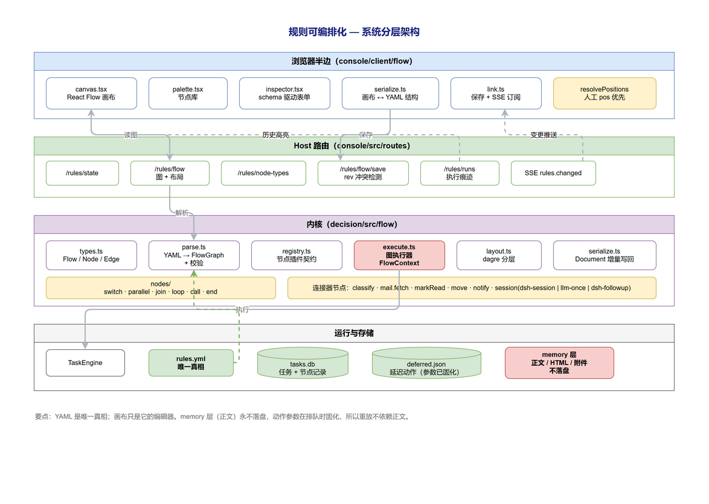
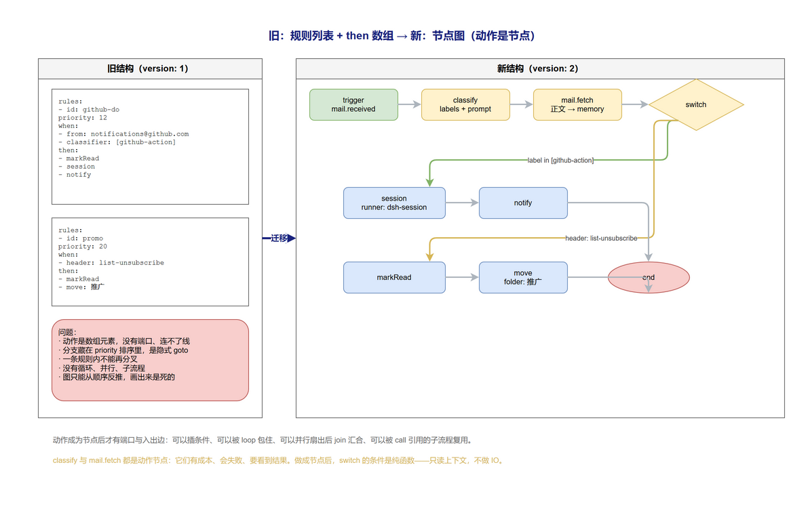
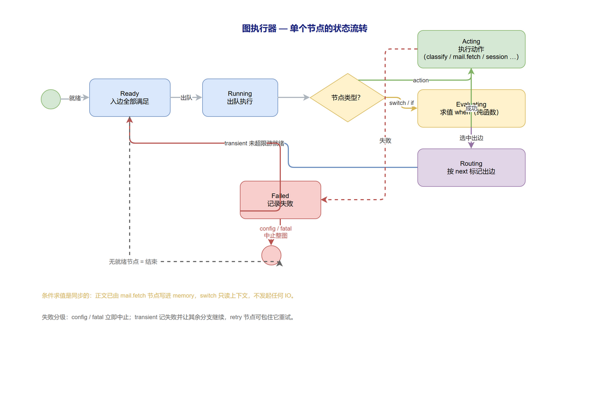
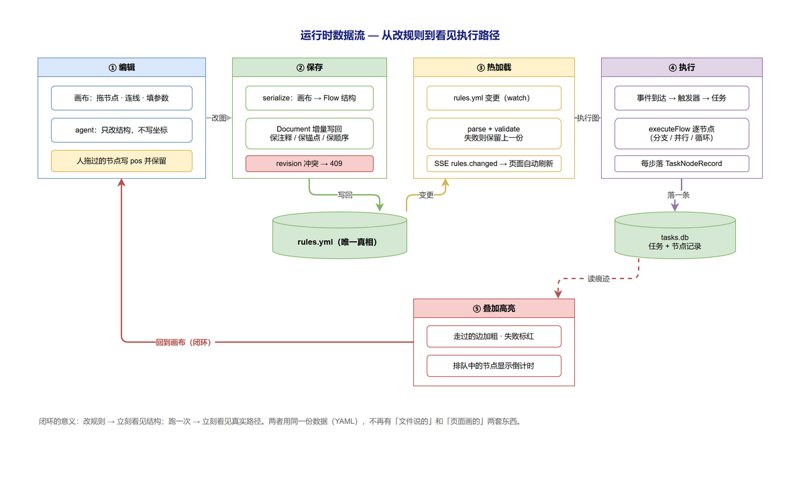

# 规则可编排化 系统分析

> 分析状态：已完成
> 本文定位：面向本仓库的初步设计，说明「把规则编辑器变成可编排的节点图」如何落到数据模型、执行器、界面与迁移。具体代码分支下沉到 `rules-orchestration-design.md`。

## 目标与非目标

### 业务目标

把工作台规则页从「只读展示 + 局部开关」变成**可编排的流程编辑器**：一条事件从触发进入，经过条件分支、动作节点、并行汇合、循环，最后收敛。图上每个方块都是**节点**，动作与条件不再是规则底下的一行字。

### 用户场景

| 场景 | 现在 | 目标 |
|---|---|---|
| 加一条「GitHub PR 通知 → 开会话 → 通知」的规则 | 手写 YAML，或在页面上复制指令交给 agent | 在画布上点「+」，选动作节点，连线，填参数 |
| 「CI 失败先重试 2 次，仍失败才开会话」 | 做不到（只有顺序） | `retry` 节点包住 `session` 节点 |
| 「同时开一个会话并通知」 | 做不到（顺序执行） | `parallel` 扇出 + `join` 汇合 |
| 「同一工单的第二封信不再重复开工」 | 会重复执行动作 | 由任务身份 + 节点级幂等策略决定 |
| 「看这条规则实际怎么走的」 | 列表文字 | 图上高亮走过的路径与当前停在哪 |

### 非目标（本设计不做）

- 不做多人协作、版本历史、审批流（BPMN 的泳道、会签）。
- 不做跨进程持久化流程（Temporal 那类）。执行仍在 DSH 进程内，靠 `tasks.json` 恢复。
- 不引入 BPMN 标准符号与 `.bpmn` 文件（决策 D-02 已排除）。
- 不改连接器契约：`TaskConnector`、`emit`、触发器/动作注册方式保持。

### 验收口径

1. 现有 11 条规则的行为在迁移后**逐条可比**：同一封邮件命中同一条规则、执行同一组动作、顺序一致。
2. 画布上能完成「新增规则 → 加分支 → 保存 → 立刻在图上看到」的闭环，不需要手改文件。
3. 改 `rules.yml` 后页面自动跟上（不再需要手动刷新）。
4. `stopOnMatch` 类语义缺口在迁移时闭合，并有回归测试证明。

## 当前事实

### 代码事实

| 位置 | 现状 |
|---|---|
| `packages/decision/src/types.ts` | `Rule = { id, name, enabled, priority, connector?, when[], label?, then[], stopOnMatch? }` —— 规则是**扁平列表**，动作是 `then` 数组 |
| `packages/decision/src/task/runner.ts` | `runChain` 依次：分类 → 按 priority 遍历规则首命中（`stopOnMatch:false` 继续）→ 按命中顺序执行各自 `then` |
| `packages/decision/src/bpmn/compile.ts` | 把规则列表编译成一串 `exclusiveGateway`；`stopOnMatch:false` 用「命中后 token 交给下一条网关」表达 |
| `packages/decision/src/bpmn/execute.ts` | 判定**预取**后才跑流程；流程内只有同步路由与动作 |
| `packages/console/src/client/rules.tsx` | 规则页：列表 + 条件值编辑 + 启停 + 排序 + 试跑 + 撤销/承认 |
| `packages/console/src/client/rule-tree.tsx` | 只读树：触发 → 规则列 → 动作 span。**动作不是节点**，无端口、不可连线 |
| `packages/console/src/client/styles.ts` | 树用 CSS flex + 0.5px 细线自绘，无布局算法 |
| `packages/decision/src/task/record.ts` | `Task.nodes` 是**已发生**的节点顺序（扁平数组，无 parentId、无边） |

### 运行态事实

- 生效规则：`~/.dsh/dsh-console/rules/rules.yml`，`version: 1`、`connector: mail`、11 条规则。
- 动作 kind 分布：`markRead` 6、`notify` 9、`session` 4、`move` 6。
- 条件 kind 分布：`from` 4、`classifier` 6、`regex` 1、`header` 1。
- 分类：6 条规则共用一次模型判定（label 并集 + `&labeldict` 锚点去重）。
- 证据：`pnpm run test` 1019 通过；`bpmn-smoke` profile 中 `/dsh-console/rules/state` 返回 11 条、`connector: true`。

### 模型事实

- 冻结的扩展点：`TaskConnector.vocabulary`（条件/动作词表）、`judge`（条件实现）、`actions`（动作节点）、`classify`（分类计划）。
- 已注册动作 kind：`markRead` `flag` `move` `archive`（邮件）+ `notify` `session` `followup` `script` `mcp` `http`（DSH）。
- 已注册条件 kind：`from` `to` `subject` `body` `header` `regex` `attachment` `classifier`。

## 差异与结论

| 差异 | 为什么现在做不到 | 结论 |
|---|---|---|
| 动作不是节点 | 动作是 `Rule.then` 数组的元素；无 id、无入边出边 | **换成节点图**，动作获得 `id/type/config/出边` |
| 只有一层分支 | `priority` 首命中是隐式 goto，一条规则内不能再分叉 | `switch` / `if` 变成节点，规则嵌套消失 |
| 无循环 | 数组表达不了回边 | `loop` / `retry` 节点 |
| 无并行 | 线性序列表达不了汇合 | `parallel` / `join` 节点 |
| 无模块化 | 无引用机制 | `call` 节点引用子流程 |
| 图不可编辑 | 树是纯展示组件 | `@xyflow/react` 画布 + 自动布局 |
| 改文件页面不变 | 规则页只在挂载时读一次 | 加 SSE 事件 + 可见时轮询兜底 |
| `stopOnMatch` 语义漂移 | 旧执行器「继续找并追加」与 BPMN 编译「token 传递」不完全等价 | 迁移时用显式 `switch` 分支表达，废弃 `stopOnMatch` |

## 已确认决策

| ID | 事项 | 结论 | 依据 |
|---|---|---|---|
| D-01 | 规则定义存在哪 | **YAML 是唯一真相**，画布是它的编辑器，改图写回 YAML | 用户确认 |
| D-02 | 节点位置怎么定 | **自动布局**（DAG 分层），YAML 不存坐标；节点/连线/配置可手动编辑 | 用户确认 |
| D-03 | 画布选型 | **@xyflow/react + @dagrejs/dagre** | 用户确认 |
| D-04 | 旧规则处置 | **开发完成后一次性转换**到 v2，转完删除 v1 解析路径。不留 v1/v2 并存、不做双写、不做「只读打开」过渡态——只有一种格式，避免两套语法长期漂移 | 用户确认 |
| D-05 | 执行器 | **自研图执行器**，不再用 bpmn-engine | 分析结论，见下 |
| D-06 | 节点插件契约 | **开放**：插件可注册节点类型，带 schema 驱动属性面板 | 用户确认 |
| D-07 | 节点间数据传递 | **流程上下文（LiteFlow 式）**：`FlowContext` 共享读写，节点不直接传参，画布无数据边 | 用户确认 |
| D-08 | 动作节点的执行器 | 节点语义与实现分离：`session` 可选 `runner: dsh-session / llm-once / dsh-followup` | 用户确认 |
| D-09 | 坐标与布局 | agent 只写结构不写坐标；人拖拽写入 `pos` 并保留；无 `pos` 的节点由布局补位，**不整图重排** | 用户确认 |
| D-10 | 节点分类 | `group` 只有三类：`trigger` / `control` / `action`。**`classify` 就是动作节点**，不再是特殊阶段 | 用户确认 |
| D-11 | 读正文 | 邮件正文由**连接器注册的动作节点**（`mail.fetch`）显式读取，进上下文；事件本身仍只带摘要 | 用户确认 |
| D-12 | 上下文分层 | `vars`（落盘，可重放）与 `memory`（**不落盘**，正文等大体积/敏感数据）。节点产出声明自己进哪一层 | 用户确认 |
| D-13 | 任务内多轮执行 | **Task 1—* Run**：同一任务的每次「新事实」开启一轮新 Run；`dedupeKey` 挡重复，`seed.key` 归同一任务。**这是 R-01 的正解** | 用户确认 |
| D-14 | 流程挂起 | 挂起是 **Run 级**状态：进度（已完成节点 / 已满足边 / 待执行队列 / 挂起点）随 Run 落盘，恢复从挂起点继续 | 用户确认 |

### D-05 的理由（实测证据）

`bpmn-engine` 在**入边被 take 的瞬间**求值网关条件，而 take 发生在源活动**开始**时。因此「异步判定 → 网关路由」必然读到未写好的变量；只能用「开跑前预取全部判定」绕过。而可编排要求**循环每轮重新判定**、**分支条件依赖上一步产出**，预取方案无法表达。故执行器自研，BPMN 编译层退役。

## 领域对象与关系

### 节点图模型

```
Flow 1 ──* Node 1 ──* Edge
                │
                └── config（动作/条件的参数，词表来自连接器）
```

| 对象 | 角色 | 关键字段 | 上下游 |
|---|---|---|---|
| `Flow` | 一张流程图，一个 YAML 文件可有多张 | `id` `name` `connector` `nodes[]` | 由 `version: 2` 文件承载 |
| `Node` | 一个执行单元 | `id` `type` `config` `out`（出边） | type 决定 config 词表 |
| `Edge` | 节点之间的走向 | `from` `to` `when?`（条件） | `when` 为空即无条件 |
| `NodeType` | 节点种类声明 | `kind` `sideEffect` `configSchema` | 来自连接器注册表 + 核心内置 |
| `Run` | 一次执行痕迹 | `flowId` `nodeId` `status` `detail` | 叠加到图上高亮 |

### 节点类型清单

| 类别 | type | 出边语义 | 来源 |
|---|---|---|---|
| 触发 | `trigger` | 单出 | 连接器触发器 |
| 分支 | `switch` | 多出，每个带 `when`，另有 `default` | 核心内置 |
| 分支 | `if` | 两出：`then` / `else` | `switch` 的语法糖 |
| 动作 | `classify` | 单出（写 `label` 到 facts） | 连接器（**动作节点**） |
| 动作 | `mail.fetch` | 单出（写正文到 `memory`） | 邮件连接器 |
| 动作 | `markRead` `flag` `move` `archive` `notify` `session` `followup` `script` `mcp` `http` | 单出 | 连接器动作 |
| 并行 | `parallel` | 多出（全走） | 核心内置 |
| 并行 | `join` | 单出（等全部入边） | 核心内置 |
| 循环 | `loop` / `retry` | 单出（体内子图） | 核心内置 |
| 组合 | `call` | 单出（引用另一张 flow） | 核心内置 |
| 终止 | `end` | 无出边 | 核心内置 |

**动作与条件是同一套节点机制**：都实现 `TaskNode`，都由注册表按 `kind` 分发。

**有两类「动作」不产生外部副作用，但仍归 action**：

- `classify`：花一次模型调用，产出 `facts.label`。它是动作而非条件——因为它有成本、会失败、要看结果。
- `mail.fetch`：读一次 IMAP，产出正文到 `memory`。同样有成本、会失败。

把它们做成节点而不是「条件的隐式 IO」之后，条件就变成了**纯函数**：只读上下文，不读外部世界。

## 流程上下文分层

| 层 | 内容 | 落盘 | 重放 |
|---|---|---|---|
| `event` | 事件投影：`from` `subject` `headers` `snippet` | ✅ | ✅ |
| `vars` | 节点产出：`label` `sessionId` 等小数据 | ✅ | ✅ |
| `facts` | 跨节点事实：分类标签与置信度 | ✅ | ✅ |
| `memory` | `body` `html` `attachments` 等大体积/敏感数据 | ❌ | ❌（重放时为空） |

变量解析顺序：`vars → memory → facts → event`。

**重放保护**：动作参数在**排队时就固化**（渲染好再存进 `deferred.json`），而不是重放时再解析。这样即使 `memory` 在重放时为空，延迟动作也不会失效——沿用现有 `PendingAction.summary` 的同一思路。

## 端到端实现路径

```
用户改图 / agent 改 YAML
        │
        ├── 画布：拖节点、连线、填参数 → 序列化成 YAML → 写 rules.yml
        └── 直接编辑 rules.yml
        │
        ▼
引擎热加载（watch）→ parseFlow() → 校验 → FlowGraph（内存）
        │
        ▼
事件到达 → emit → 触发器 → 建任务 → executeFlow(graph, context)
        │
        ├── 逐节点执行：条件求值 / 动作执行 / 分支选择 / 并行汇合 / 循环
        ├── 每个节点落一条 TaskNodeRecord（含 parentId 支持嵌套）
        └── 延迟/撤销/建议 仍在节点级生效
        │
        ▼
tasks.json 持久化 → 看板与规则页读同一份 → 画布叠加运行时高亮
```

| 步骤 | 入口/模块 | 处理 | 输出 |
|---|---|---|---|
| 1 | `rules.yml` | 热加载解析、校验、展开旧 `rules:` 简写 | `FlowGraph` |
| 2 | `TaskEngine.emit` | 触发器接事件、建/取任务 | `Task` |
| 3 | `executeFlow` | 拓扑遍历、节点执行、分支与汇合 | `TaskNodeRecord[]` |
| 4 | 画布 | 读 `/rules/flow` 得图 + 布局；读 `/rules/runs` 得痕迹 | 高亮路径 |
| 5 | 编辑 | 画布操作 → 写回 YAML → 引擎重载 → 页面刷新 | 新图 |

## 各端改动

### decision（内核）

- 新增 `src/flow/`：`types.ts`（Flow/Node/Edge）、`parse.ts`（YAML → FlowGraph + 校验）、`serialize.ts`（FlowGraph → YAML，保序保注释）、`execute.ts`（图执行器）、`layout.ts`（DAG 分层，给画布用）。
- 新增 `src/flow/nodes/`：`switch.ts` `parallel.ts` `join.ts` `loop.ts` `call.ts` `end.ts`（内置控制流节点）。
- 修改 `task/runner.ts`：`runChain` 改为 `executeFlow`。
- 修改 `task/record.ts`：`TaskNodeRecord` 增 `flowId` `parentId` `path`（嵌套定位）。
- 退役 `bpmn/`（编译与执行），保留到迁移完成后再删。

### console（Host）

- 新增路由：`/rules/flow`（GET，返回图 + 布局）、`/rules/node`（POST，增删改一个节点）、`/rules/edge`（POST，增删一条边）、`/rules/flow/save`（POST，整图保存）。
- 修改 `/rules/state`：附带 `version` 与 `flows[]`，页面据此知道是 v1 还是 v2。
- 新增 SSE 事件 `rules.changed`，规则文件变化时推送。

### console（浏览器）

- 新增 `src/client/flow/`：`canvas.tsx`（React Flow 画布）、`node-*.tsx`（各类型节点外观）、`inspector.tsx`（节点属性面板）、`palette.tsx`（节点库，从 `/rules/node-types` 取可用 kind）、`to-yaml.ts`（画布状态 → YAML 结构体）。
- 修改 `rules.tsx`：视图切换「列表 / 流程」，流程视图用画布。
- 删除 `rule-tree.tsx`（被画布取代）。
- 新增依赖 `@xyflow/react`、`@dagrejs/dagre`，CSS 内联注入（照 bpmn-js 那次的验证方式）。

### mail / connector-dsh

- 无需改动。动作与条件仍在各自包里注册；`vocabulary` 增加一个可选 `nodeMeta`（字段说明、默认值），供属性面板渲染。缺失时面板退化为 JSON 编辑。

## 状态、权限与异常

| 情形 | 处理 |
|---|---|
| 规则文件语法错 | 保留上一份可用图，页面顶部报错并指到行（沿用现有行为） |
| 图结构非法（孤立节点、悬空边、环） | 解析期拒绝并指出节点 id；环只允许出现在 `loop` 体内 |
| 画布保存冲突（文件在此期间被 agent 改过） | 保存前比对 mtime/revision，不一致则拒绝并提示「先刷新」 |
| 动作失败 | 节点记 `ok:false`，默认继续后面的节点（`failure` 标明性质） |
| 延迟/撤销/建议 | 仍在节点级：`sideEffect` 节点按撤销窗口排队；`suggest` 已随三态移除，不再有 |
| 循环不收敛 | `loop` 必须有 `times` 或 `until`，解析期校验；运行时另有硬上限 |
| 并行分支部分失败 | `join` 收齐后汇总；部分失败记 `partial` |

## 任务内的多轮执行（D-13）

### 两种「重复」必须分开

| | 语义 | 正确行为 |
|---|---|---|
| **重复** | 同一个事实被再次通知（`dedupeKey` 相同） | 跳过 |
| **再次发生** | 同一件事的新事实（同一 `key`，不同事件） | **开启新的一轮执行** |

一个 PR 收到三条评论是三件事，都该处理；一条通知被投递两次是一件事，只该处理一次。现有执行器把两者都当成「重跑整链」，于是前者重复副作用动作，后者重放旧动作。

### 模型

```
Task（一件事，看板一张卡）
 └─ Run[]（多次执行）
      └─ FlowProgress（这一轮跑到哪了，可挂起）
      └─ TaskNodeRecord[]（这一轮走过的节点）
```

两个身份字段正好对应两层：

| 字段 | 挡什么 | 落到模型 |
|---|---|---|
| `dedupeKey` | 同一事实重复到达 | 不新建 Run |
| `seed.key` | 同一件事的多次发生 | 归到同一 Task，**新建 Run** |

`runChain` 的重入（延迟到期、重启恢复）续跑**原来那个 Run**，不新建。

转换器是**一次性脚本**，不留在运行时代码里。回滚靠转换前的备份（沿用目录里已有的 `.bak-*` 习惯）。

## 流程挂起（D-14）

挂起是 **Run 级**状态，不是 Task 级：一轮执行停在中途，等信号恢复，其余轮次不受影响。

```ts
interface FlowProgress {
  readonly done: readonly string[]        // 已完成的节点
  readonly satisfied: readonly string[]   // 已满足的边 `${from}->${to}`
  readonly ready: readonly string[]       // 待执行队列
  readonly suspendedAt?: string           // 停在哪个节点
}
```

### 三类挂起点

| 类型 | 恢复触发 | 例子 |
|---|---|---|
| `await-event` | 同一 Run 的新信号 | 「等 CI 结果回来再通知」 |
| `await-human` | 人点批准/驳回 | 「推送前等我确认」 |
| `await-timer` | 定时器到期 | 「30 分钟后没回就催」 |

现有 `deferred.json` 是 `await-timer` 的退化版（只用于延迟动作）；挂起是它的超集。

### 状态与约束

`RunStatus` 增加 `suspended`：`running → suspended`，`suspended → running`（恢复），`suspended → done/failed/skipped`（超时终止）。

**跨挂起的硬约束**：`memory` 层不落盘，恢复后为空。因此跨越挂起点的下游节点不能依赖上一次读到的正文——要么恢复后重新 `mail.fetch`，要么在挂起前把需要的那几行写进 `vars`。这是「正文不落盘」的必然代价，不是实现缺陷。

## 语义缺口的闭合口径

六项全部闭合，不再有待复核项。

| ID | 原缺口 | 闭合方式 | 状态 |
|---|---|---|---|
| R-01 | 同一任务重复事件重跑整链，动作重复 | **Task 1—* Run**（D-13）：新事实开新 Run，重复事实被 `dedupeKey` 挡住 | 已解决 |
| R-02 | 同一任务重复事件重复分类 | 同上：分类是 Run 内的一个节点，每轮各跑一次，不再跨轮重放 | 已解决 |
| R-03 | `stopOnMatch: false` 两条实现路径语义不一致 | 旧语义消失：命中后继续由**显式 `switch` 的多条出边**表达，不再靠数组排序 | 已解决 |
| R-04 | `connector: '*'` 兜底规则收所有连接器事件 | **就是设计意图**：任何事件都该能触发通知，`notify` 是普通动作节点，可放在任意位置 | 已确认 |
| R-05 | 动作失败只记 `partial`，看不出哪个失败 | 节点记录本身带 `ok: false` + `failure` + `nodeId`；看板与画布按节点着色，读不到「从哪断」的问题消失 | 已确认 |
| R-06 | `session` 开会话后撤不回来，但 undo 返回成功 | **会话可以停止**：`session` 节点执行时登记 `undo = () => stopSession(id)`；撤销即停止该会话。会话已结束时停止是 no-op，如实报告「会话已结束，无需停止」 | 已确认 |

R-04 的补充：`notify` 是动作节点这一点决定了兜底规则的形状——它不是「特殊能力」，只是一条把 `notify` 放在 `trigger` 后面的普通流程。

R-06 的补充：这让「撤销」重新变成**真的能撤销**，而不是靠措辞含糊。停止会话用 DSH 已有的 `interrupt` / `end` 能力，不需要新机制。

## 逻辑图

> 所有图都有 draw.io 可编辑源文件（`docs/images/src/`）与导出的 PNG。要改布局，用 draw.io 打开源文件。

### 目标架构



源文件：[`rule-orchestration-architecture.xml`](images/src/rule-orchestration-architecture.xml)

### 旧 vs 新结构



源文件：[`rule-orchestration-old-new.xml`](images/src/rule-orchestration-old-new.xml)

### 执行器节点状态机



源文件：[`rule-orchestration-executor-state.xml`](images/src/rule-orchestration-executor-state.xml)

### 运行时数据流（闭环）



源文件：[`rule-orchestration-runtime-flow.xml`](images/src/rule-orchestration-runtime-flow.xml)

## 初步实现方案与详细设计映射

| 方案 | 涉及位置 | 详细设计章节 | 验收信号 |
|---|---|---|---|
| S1 节点图数据模型与 YAML v2 语法 | `decision/src/flow/types.ts`、`parse.ts` | §1 §2 | 解析 11 条等价规则，图结构断言通过 |
| S2 图执行器（含上下文分层与重放固化） | `decision/src/flow/execute.ts` | §3 | 分支/并行/循环/重试各有测试；`memory` 不落盘 |
| S3 节点插件契约（动作即节点，`group` 三类） | `decision/src/flow/registry.ts`、`connector.ts` 增 `nodes` | §4 | 面板能列出全部可用 kind；`classify` 与 `mail.fetch` 都在动作库 |
| S4 读正文节点 `mail.fetch` | `mail/src/nodes/fetch.ts` | §4.1 | 正文进 `memory`，任务记录里搜不到正文 |
| S5 自动布局与手动位置 | `decision/src/flow/layout.ts` | §5 | 同一图多次布局坐标稳定；人工 `pos` 不被覆盖 |
| S6 画布与写回 | `console/src/client/flow/` | §6 §7 | 加节点→连线→保存→重载，图不变形 |
| S7 运行时高亮 | `console/src/client/flow/` | §8 | 一条真实执行后图上路径高亮 |
| S8 规则迁移 | `~/.dsh/dsh-console/rules/rules.yml` | §10 | 一次性转换；11 条逐条比对表全部一致；转完 v1 路径删除 |
| S9 缺口闭合 | R-01…R-06 的六条口径 | §3 §10 | 每项一条回归测试 |

## Plan 已确认结论与阻断

| 事项 | 结论 | 依据 | 状态 |
|---|---|---|---|
| D-01 定义存储 | YAML 是源，图是编辑器 | 用户回答 | 已确认 |
| D-02 布局 | 自动布局，不存坐标，内容可手动编辑 | 用户回答 | 已确认 |
| D-03 画布 | @xyflow/react + dagre | 用户回答 | 已确认 |
| D-04 旧规则 | 开发完成后**一次性转换**，转完删 v1 路径；不留并存态 | 用户回答 | 已确认 |
| D-05 执行器 | 自研，退役 bpmn-engine | 实测：gateway 提前求值阻断异步分支 | 已确认 |
| R-01…R-06 | 六项语义缺口全部闭合（见「语义缺口的闭合口径」） | 代码分析 + 用户确认 | 已确认 |
