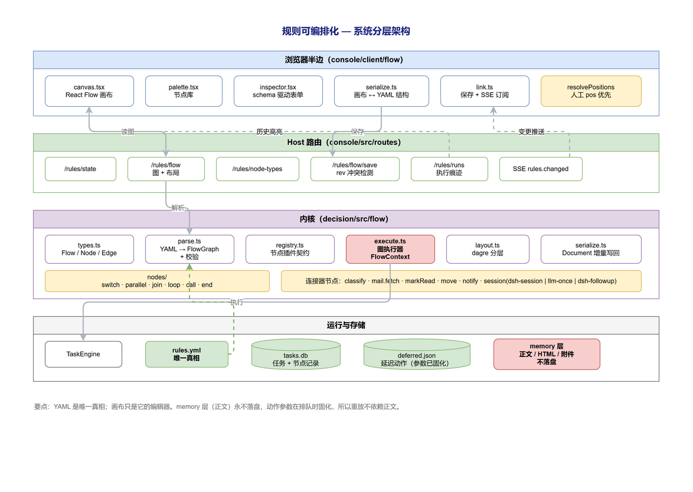
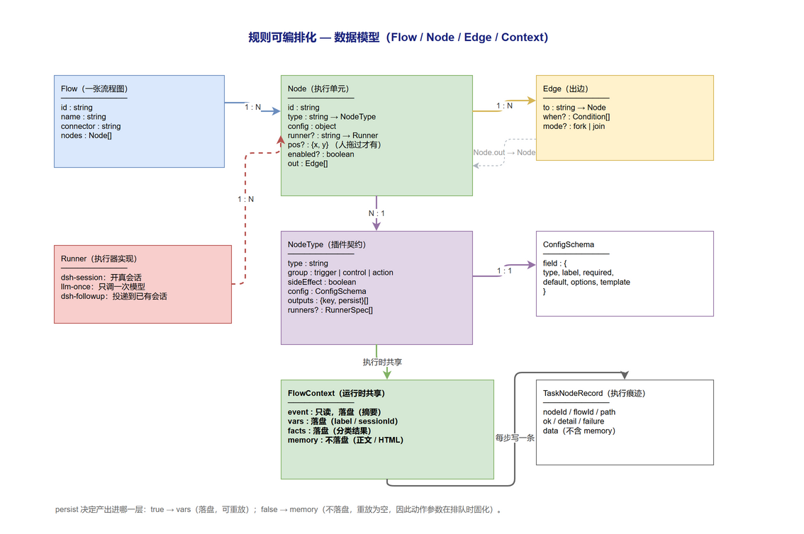
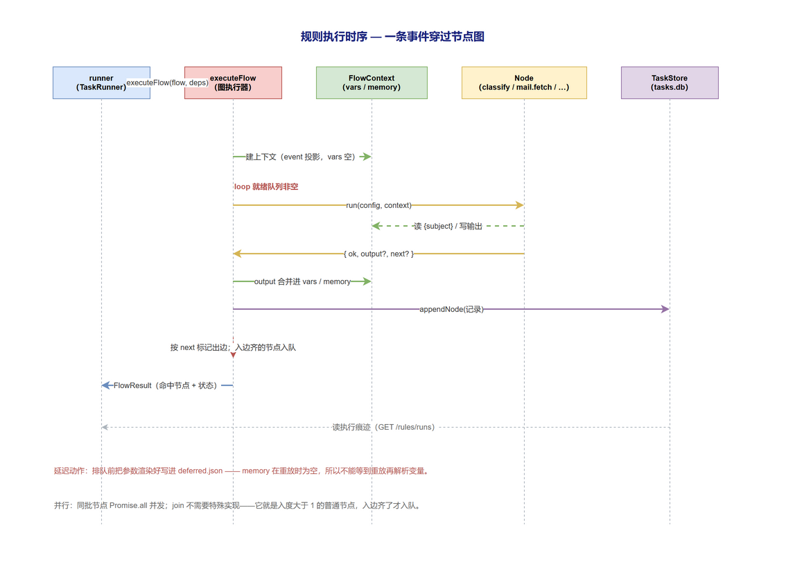
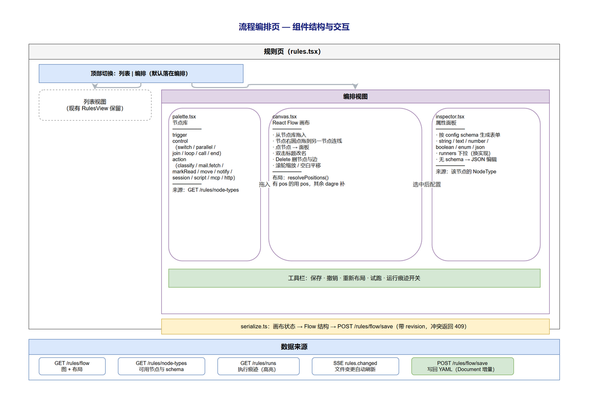

# 规则可编排化 详细设计

> 上游：`docs/rules-orchestration-analysis.md`（决策 D-01 ~ D-09）
> 本文定位：让开发者看完能直接定位文件、写代码，不需要再猜入口、结构或数据语义。

## 总览



源文件：[`docs/images/src/rule-orchestration-architecture.xml`](images/src/rule-orchestration-architecture.xml)

完整的七张图：

| 图 | PNG | draw.io 源文件 |
|---|---|---|
| 系统分层架构 | [architecture](images/rule-orchestration-architecture.png) | [xml](images/src/rule-orchestration-architecture.xml) |
| 数据模型 ER | [data-model](images/rule-orchestration-data-model.png) | [xml](images/src/rule-orchestration-data-model.xml) |
| 执行时序 | [execute-sequence](images/rule-orchestration-execute-sequence.png) | [xml](images/src/rule-orchestration-execute-sequence.xml) |
| 执行器状态机 | [executor-state](images/rule-orchestration-executor-state.png) | [xml](images/src/rule-orchestration-executor-state.xml) |
| 旧 vs 新结构 | [old-new](images/rule-orchestration-old-new.png) | [xml](images/src/rule-orchestration-old-new.xml) |
| 画布组件树 | [canvas-components](images/rule-orchestration-canvas-components.png) | [xml](images/src/rule-orchestration-canvas-components.xml) |
| 运行时数据流闭环 | [runtime-flow](images/rule-orchestration-runtime-flow.png) | [xml](images/src/rule-orchestration-runtime-flow.xml) |

---

## §1 节点图数据模型

### 1. 结果

规则不再是「列表 + then 数组」，而是**一张图**：节点有 id、类型、配置、出边；动作与条件都是节点。流程上下文承载节点间的数据。

### 2. 入口与修改位置

| 文件 | 动作 |
|---|---|
| `packages/decision/src/flow/types.ts` | 新增 |
| `packages/decision/src/index.ts` | 导出 `./flow/index.ts` |

### 3. 数据结构



源文件：[`rule-orchestration-data-model.xml`](images/src/rule-orchestration-data-model.xml)

```ts
/** 一张流程图。 */
export interface Flow {
  readonly id: string
  readonly name: string
  /** 归属连接器；决定条件/动作词表。 */
  readonly connector: string
  readonly nodes: readonly FlowNodeSpec[]
}

/** 图上的一个节点。 */
export interface FlowNodeSpec {
  readonly id: string
  /** 节点类型：动作 kind 或控制流 kind。 */
  readonly type: string
  /** 节点配置；词表由节点类型声明。 */
  readonly config?: Readonly<Record<string, unknown>>
  /** 出边。缺省 = 无边（终止节点）。 */
  readonly out?: readonly FlowEdgeSpec[]
  /** 仅动作节点：实现选择器（D-08）。 */
  readonly runner?: string
  /** 人拖拽过才有；agent 不写。渲染信息，不参与执行。 */
  readonly pos?: { readonly x: number; readonly y: number }
  readonly enabled?: boolean
  readonly label?: string
}

/** 一条出边。 */
export interface FlowEdgeSpec {
  readonly to: string
  /** 条件；为空即无条件。switch 的每个分支都有。 */
  readonly when?: readonly ConditionSpecLike[]
  /** 同一次路由里，是否等待其它分支（并行汇合用）。 */
  readonly mode?: 'fork' | 'join'
}
```

### 4. 流程上下文（D-07 / D-12）

```ts
/** 一次执行的共享上下文：节点读写它，节点之间不直接传参。 */
export interface FlowContext {
  /** 事件投影，只读，落盘。例：`{ subject, from, repo }`。不含正文。 */
  readonly event: Readonly<Record<string, string>>
  /** 节点产出，**落盘**：label、sessionId 这类小数据。 */
  readonly vars: Record<string, unknown>
  /** 节点产出，**不落盘**：正文、HTML、附件列表。执行结束即销毁。 */
  readonly memory: Record<string, unknown>
  /** 跨节点事实，落盘。 */
  readonly facts: { label?: string; confidence?: number }
  readonly taskId: string
  readonly flowId: string
  /** 落一条节点记录。 */
  record(entry: FlowNodeRecord): Promise<void>
  log(line: string): void
}
```

变量引用语法沿用现有 `fillTemplate` 的 `{name}`，解析顺序：

```
vars[name]  →  memory[name]  →  facts[name]  →  event[name]  →  空串
```

`vars` 优先于 `event`：节点产出比事件原文更具体（与现有 `varsOf` 的注释一致）。
`memory` 排在 `vars` 之后：同名时以持久层为准，避免重放时行为漂移。

### 4.1 落盘边界

| 位置 | 写什么 | 谁决定 |
|---|---|---|
| `Task.event.payload` | 摘要：账号、目录、uid、from、subject、headers、snippet | 连接器触发器（不含正文） |
| `Task.vars` | 节点声明的 `persist: true` 产出 | 节点 `outputs` 声明 |
| `TaskNodeRecord.data` | 每步的结构化证据；**不含 `memory` 内容** | 执行器 |
| `memory` | 正文等大体积数据 | **不落任何文件** |

序列化任务时，`memory` 层直接丢弃。若某节点的 `config` 引用了 `memory` 变量，执行器在**排队/落盘前把渲染结果固化**进记录，重放时不再解析（与现有 `PendingAction.summary` 同一思路）。

### 5. 异常与边界

- `id` 在单个 flow 内唯一，解析期校验。
- `type` 必须是已注册节点类型；未知 type 保留节点但标 `enabled: false` 并在页面提示（**不丢整图**，否则一个拼错的 type 会让整份规则不可用）。
- `pos` 只接受有限数；非法值忽略。

### 6. 验证

- `flow/types.ts` 只有类型，无运行时代码；`pnpm typecheck` 通过即算。
- 单测：构造一份含 `pos` / 无 `pos` / 非法 `pos` 的 flow，断言解析后结构符合预期。

---

## §2 YAML v2 语法与解析

### 1. 结果

`rules.yml` 只有一种语法：**version: 2 节点图**。v1 不保留读路径——迁移靠一次性脚本（见 §5），转完即删。

### 2. 入口与修改位置

| 文件 | 动作 |
|---|---|
| `packages/decision/src/flow/parse.ts` | 新增：`parseRuleFileV2`（只认 v2，遇到 v1 直接报错并指向迁移脚本）|
| `packages/decision/src/task/engine.ts` | 修改 `reloadRules`：识别 `version: 2` 走图解析 |

### 3. 语法形态

```yaml
version: 2
connector: mail

flows:
  - id: mail-triage
    name: 邮件分诊
    nodes:
      - id: start
        type: trigger
        config: { event: mail.received }
        out: [{ to: classify }]

      - id: classify
        type: classify
        config:
          labels: [security, todo, dev, newsletter]
          prompt: &labeldict |
            security   —— 账号、登录、扣费异常
            todo       —— 真人发来、需要我处理
          model: deepseek-chat
        out: [{ to: route }]

      - id: read-body
        type: mail.fetch
        config:
          fields: [text]
          maxBytes: 32768
        out: [{ to: route }]

      - id: route
        type: switch
        out:
          - { to: gh-do, when: [{ kind: label, in: [github-action] }] }
          - { to: promo, when: [{ kind: header, name: list-unsubscribe }] }
          - { to: jira, when: [{ kind: regex, field: body, pattern: 'EXEPD-\d+' }] }
          - { to: rest, mode: join }        # 兜底：默认分支

      - id: gh-do
        type: session
        runner: dsh-session
        config:
          workspaceTemplate: '{repoRoot}/{repo}'
          prompt: '处理 GitHub 通知：{subject}'
          preset: mail-github-worker
        out: [{ to: gh-notify }]

      - id: gh-notify
        type: notify
        config: { title: 'GitHub：{subject}', tone: info }
        pos: { x: 540, y: 260 }             # 人拖过才有
        out: [{ to: done }]

      - id: promo
        type: move
        config: { folder: '推广' }
        out: [{ to: done }]

      - id: rest
        type: end
      - id: done
        type: end
```

### 4. 简写

| 简写 | 展开 |
|---|---|
| `next: a` | `out: [{ to: a }]` |
| `next: [a, b]` | `out: [{to:a, mode:'fork'}, {to:b, mode:'fork'}]` |
| `then: a` / `else: b`（`if` 节点） | `out: [{to:a, when:[...]}, {to:b}]` |
| 无 `out` | 终止 |

简写只在解析期存在，内部统一成 `out`。

### 5. 一次性迁移（D-04，无过渡态）

**不保留 v1 解析路径**。切换是单向的，所以 §2 的解析器只认 `version: 2`；v1 的展开逻辑放在**一次性脚本**里，不属于运行时。

| 时点 | 状态 | 谁在跑 |
|---|---|---|
| T0 开发中 | `rules.yml` 仍是 v1 | 旧引擎（`bpmn/` 与旧 `runner`），行为不变 |
| T1 新引擎就绪 | 新引擎能吃 v2；11 条样本对比通过 | 两套代码都在仓库，但只有一套被加载 |
| T2 **转换** | 跑一次 `scripts/migrate-rules-v2.ts`：备份 → 展开 → 校验 → 覆盖 | 切换点 |
| T3 收尾 | 删 v1 展开逻辑、删 `bpmn/` 目录；只认 v2 | 终态 |

转换脚本的职责（跑完可删）：

```ts
// scripts/migrate-rules-v2.ts —— 一次性，不进 lib
1. 读 rules.yml（version: 1）
2. 备份到 rules.yml.bak-before-v2-<ISO 时间戳>
3. expandV1Rules() → Flow[]：每条规则一个 switch 分支，then 展开成串联节点
4. classify 条件的 labels/prompt 收敛进**一个** classify 节点；`&labeldict` 锚点随之消失
5. 校验：node id 唯一、边不悬空、`{var}` 有生产者
6. 写 version: 2
7. 打印「规则数 / 节点数 / 丢弃数」供人工核对
```

**为什么不留兼容读**：两套语法同时可写时，在 v1 里改的规则会让 v2 的图过期，哪边是真相只能靠记忆。删除 v1 路径是让漂移无法发生，而不是靠纪律避免。

回滚：`rules.yml.bak-before-v2-*` 换回即可（此时旧引擎代码仍可用 `git revert` 找回）。

v1 一条规则 `{ id, priority, when, then }` 展开为：

```
switch(route) ─[when 成立]→ 动作1 → 动作2 → end
              ─[else]→ 下一条规则的 switch
```

即 §2 现在 `compileRules` 的同一形状，只是从「编译」变成「解析期展开」，且 `stopOnMatch: false` 用显式 `mode: fork` 表达。

> **这段展开逻辑只活在一次性的 `scripts/migrate-rules-v2.ts` 里**，不在运行时。运行时遇到 `version: 1` 直接报错，提示先跑迁移脚本——不存在「一边跑 v1 一边能编辑 v2」的状态。

### 6. 实现步骤

1. `parseDocument(source)` → 读 `version`。
2. `version !== 2` → 拒绝并提示：`规则文件是旧格式，请先运行 scripts/migrate-rules-v2.ts`。
3. `version === 2` → 校验 `flows[]` 结构 → 直接得 `Flow[]`。
4. 校验项：
   - node id 唯一、非空
   - 每条 `out.to` 指向存在的 node
   - 除 `end` 外至少一条出边；除 `trigger` 外至少一条入边
   - 环检测：只允许 `loop` 节点的 `body` 内部有环（见 §3.6）
   - `{var}` 引用：解析期能确定产出键的（`classify` → `label`），检查是否存在生产者；否则只告警
5. 失败 → 返回结构化错误 `{ message, nodeId?, line? }`，引擎保留上一份可用图。

### 7. 异常与边界

| 情形 | 行为 |
|---|---|
| 未知 `type` | 节点保留，标 `unknown`，执行到它时记失败 `config`，其余照跑 |
| 悬空边 | 整图拒绝 |
| 孤立节点 | 告警，不拒绝（可能正在编辑） |
| 变量引用无生产者 | 告警；运行时解析为空串 |
| 语法错 | 拒绝，保留上一份，页面指行 |

### 8. 验证

- 单测：v1 展开后与现有 11 条规则逐条等价（见 §10）。
- 单测：悬空边、重复 id、未知 type 各一条断言。
- 校验脚本：`parse.ts` 对 `packages/mail/defaults/basic.yml` 与用户 rules.yml 均返回 0 错误。

---

## §3 图执行器

### 1. 结果

一条事件进入图后，节点按依赖顺序执行；switch 选路、parallel 并发、join 汇合、loop 迭代、call 引用子流程。每个节点落一条记录。

### 2. 入口与修改位置

| 文件 | 动作 |
|---|---|
| `packages/decision/src/flow/execute.ts` | 新增 `executeFlow` |
| `packages/decision/src/task/runner.ts` | `runChain` 改为调用 `executeFlow` |
| `packages/decision/src/task/record.ts` | `TaskNodeRecord` 增 `flowId` `nodeId` `path` |
| `packages/decision/src/bpmn/*` | 退役（保留到迁移完成） |

### 3. 调用链



源文件：[`rule-orchestration-execute-sequence.xml`](images/src/rule-orchestration-execute-sequence.xml)

### 4. 调度算法

```ts
async function executeFlow(flow: Flow, deps: FlowDeps): Promise<FlowResult> {
  const context = makeContext(flow, deps)
  const satisfied = new Set<string>()          // 已满足的边：`${from}->${to}`
  const done = new Set<string>()
  const ready: string[] = [entryOf(flow)]      // trigger 或入度为 0 的节点
  let failed: FailureKind | undefined

  while (ready.length > 0) {
    const batch = ready.splice(0, ready.length)
    // 同批并发：parallel 扇出的分支真正同时跑
    const results = await Promise.all(batch.map(id => runNode(flow, id, context, deps)))
    for (const result of results) {
      done.add(result.id)
      if (!result.ok) failed = worst(failed, result.failure ?? 'transient')
      const next = result.next ?? defaultNext(flow, result.id)
      for (const edge of flow.edgesOf(result.id)) {
        if (!next.includes(edge.to)) continue
        satisfied.add(edgeKey(result.id, edge.to))
        if (allInboundSatisfied(flow, edge.to, satisfied) && !done.has(edge.to)) ready.push(edge.to)
      }
    }
  }
  return { matched: [...done], status: statusOf(failed, done) }
}
```

关键点：

- **就绪判据是「所有入边满足」**，所以 `join` 不需要特殊实现——它就是入度 > 1 的普通节点。
- **同批并发**：`Promise.all` 让 `parallel` 扇出真正并行；顺序分支只有一条，等同串行。
- **`next` 缺省** = 所有出边；`switch` 返回选中的 `to`。

### 5. switch 节点

```ts
export const switchNode: FlowNode = {
  type: 'switch',
  group: 'control',
  async run(spec, context) {
    for (const edge of spec.out ?? []) {
      if (edge.when === undefined) continue              // 兜底边最后再看
      if (await evaluate(edge.when, context)) return { ok: true, detail: `${edge.to}`, next: [edge.to] }
    }
    const fallback = spec.out?.find(edge => edge.when === undefined)
    return fallback === undefined
      ? { ok: true, detail: '无分支命中', next: [] }
      : { ok: true, detail: `兜底 ${fallback.to}`, next: [fallback.to] }
  },
}
```

`evaluate` 复用现有 `ruleMatches` + 连接器 `judge`，条件求值是**异步**的——这正是自研执行器的理由（bpmn-engine 无法表达）。

### 6. loop / retry 节点

循环不引入图上的回边，而是**复合节点**：`body` 是内联子图，外层节点负责迭代。

```yaml
- id: retry-ci
  type: loop
  config:
    times: 2                # 或 until: [{ kind: classifier, labels: [ok] }]
    breakOn: success
  body:                     # 内联子图，节点 id 在子作用域内
    - id: run-test
      type: script
      config: { command: npm, args: [test] }
      out: [{ to: end-b }]
    - id: end-b
      type: end
  out: [{ to: session }]
```

执行：

```ts
async function runLoop(spec, context, deps) {
  const times = spec.config?.times ?? 1
  for (let i = 0; i < times; i++) {
    const inner = await executeFlow(inlineFlow(spec), { ...deps, context: child(context, i) })
    if (spec.config?.breakOn === 'success' && inner.status === 'done') return ok(i)
    if (spec.config?.until && await evaluate(spec.config.until, context)) return ok(i)
  }
  return ok(times)
}
```

- 循环体有自己的子上下文（`child()` 继承 vars 但产出不污染外层，除非显式声明）。
- `times` 与 `until` 必须有一个，解析期校验；运行时另有硬上限 100。

### 7. 多轮执行与挂起（D-13 / D-14）

#### 结果

同一任务的每次「新事实」开启一轮独立执行；一轮可以停在中途，等信号从停下的地方继续。两者合起来消除 R-01 的重复副作用。

#### 修改位置

| 文件 | 动作 |
|---|---|
| `decision/src/task/record.ts` | `Task` 增 `runs: Run[]`；新增 `Run` 与 `RunStatus`；`TaskNodeRecord` 增 `runId` |
| `decision/src/flow/types.ts` | 增 `FlowProgress` |
| `decision/src/flow/execute.ts` | `executeFlow` 接受 `progress?`，返回新进度；支持 `suspend` |
| `decision/src/task/runner.ts` | `runChain` 改为「建/取 Run → 续跑」；不再无条件重跑整链 |
| `decision/src/task/store.ts` | 落盘结构升级（v1 → v2，带 runs） |

#### Run 模型

```ts
export type RunStatus = 'running' | 'suspended' | 'done' | 'partial' | 'skipped' | 'failed'

/** 一次执行。同一任务的每次「新事实」开一轮。 */
export interface Run {
  readonly id: string
  /** 哪次事件触发的（`TaskEvent.dedupeKey`）；同一事实不会再开一轮。 */
  readonly eventKey?: string
  readonly startedAt: string
  readonly status: RunStatus
  /** 这一轮的进度；`suspended` 时非空。 */
  readonly progress?: FlowProgress
  /** 这一轮走过的节点。 */
  readonly nodes: readonly TaskNodeRecord[]
}

export interface Task {
  …
  /** 多次执行，最新的在前。看板一张卡展开成多轮。 */
  readonly runs: readonly Run[]
}
```

**谁是「新事实」由 `dedupeKey` 判定**：`dedupeKey` 命中既有 Run → 不新建；否则归到同一 `Task`（`seed.key`）并新建 Run。

#### 节点如何挂起

```ts
export type NodeResult =
  | { ok: true; detail: string; output?: Record<string, unknown>; next?: readonly string[] }
  | { ok: false; message: string; failure: FailureKind; next?: readonly string[] }
  /** 挂起：不再往下走，等 signal 恢复。 */
  | { ok: true; suspend: SuspendSpec; detail: string }

interface SuspendSpec {
  readonly on: 'event' | 'human' | 'timer'
  /** on: 'timer' 时的到期时间。 */
  readonly dueAt?: string
  /** 恢复时交给节点的信号载荷。 */
  readonly resume?: Record<string, unknown>
}
```

#### 执行器改动

```ts
async function executeFlow(flow, deps, progress?: FlowProgress): Promise<FlowResult> {
  const state = progress ?? { done: [], satisfied: [], ready: [entryOf(flow)] }
  const context = restoreContext(flow, deps, progress)   // vars/facts 来自落盘；memory 为空
  while (state.ready.length > 0) {
    const id = state.ready.shift()!
    const result = await runNode(flow, id, context, deps)
    if (isSuspend(result)) {
      state.suspendedAt = id
      await deps.saveProgress(state)                     // 落盘，Run.status = suspended
      return { status: 'suspended', progress: state }
    }
    state.done.push(id)
    … // 按 next 标记 satisfied，入边齐的入 ready
    await deps.saveProgress(state)                       // 每步落盘，崩溃可续
  }
  return { status: statusOf(), progress: state }
}
```

**每步落盘**：与「动作参数排队时固化」同一思路——崩溃或重启后不必重跑副作用动作。

#### 四个入口的差别

| 入口 | 行为 |
|---|---|
| 新事件（`dedupeKey` 未见过） | 同一 Task 新建 Run，从 `trigger` 开始 |
| 新事件（`dedupeKey` 已见过） | 不新建，直接返回既有 Run |
| 同一 Run 的信号 | `resume(runId, signal)` 从 `suspendedAt` 续跑，**不新建 Run** |
| 延迟动作到期 / 重启恢复 | 续跑原有 Run |

#### 异常与边界

| 情形 | 行为 |
|---|---|
| 恢复时节点已从流程里删掉 | 记 `config` 失败，该 Run 终止并说明 |
| 恢复时 `memory` 需要的正文缺失 | 下游依赖正文的节点应自带 `mail.fetch`；运行时报 `config` 并指出该节点 |
| 同一 Run 反复挂起 | 单 Run 挂起次数上限 50，超过记 `fatal` |
| 挂起期间规则文件大改 | 进度按 node id 引用；找不到就终止并说明 |
| 一轮还在跑时又来新事件 | 新事件开新 Run；同一 Run 不允许并发两个执行（`inFlight` 键从 `dedupeKey` 改为 `runId`） |

#### 验证

| 用例 | 断言 |
|---|---|
| 两轮执行 | 同一 key 两个不同 `dedupeKey` 的事件 → `task.runs.length === 2`，每轮节点各自独立 |
| R-01 回归 | 两轮都含 `session` 节点，但第一轮的 `session` 只执行一次、不被第二轮改写 |
| 重复事实 | 同一 `dedupeKey` 两次 → `runs.length === 1` |
| 挂起后续跑 | 流程停在 `wait` 节点，`run.status === 'suspended'`；恢复后执行剩余节点，已完成节点不重跑 |
| 崩溃续跑 | 模拟进程重启，从 `tasks.db` 读进度继续 |
| 超时终止 | `await-timer` 到期后 `suspended → done` |

#### 落地实现的差异（2026-11 实现）

上面是设计稿。真正落地的形态比它更收敛——**没有引入 Run 对象**，一条任务只有一份 `Task.progress`，重跑由 `task.status === 'suspended' && task.progress` 判定：

| 设计稿 | 落地 |
|---|---|
| `Run` / `RunStatus` / `runs: Run[]` | 保留 `TaskNodeRecord.runId`；进度就是 `task.progress`（`FlowProgress`），同一任务不并发两轮 |
| `SuspendSpec` 只有 on/dueAt/resume | 加 `token`：由节点给，缺省按 `任务:节点:第几次挂起` 生成；`FlowProgress.pending: PendingWait` 把「在等什么、等到什么时候、令牌是什么」整条落盘，恢复时才知道「等到了什么」 |
| 只有节点能 `suspend` | 动作也能：`ActionOutcome.wait?: SuspendSpec`（`NodeOutcome.wait` 同名），经 `executeAction`/`runWorkflow` 一路抬到图上；子工作流挂起会提升成整条链挂起（`pending.nested = { flowId, progress }`），唤醒后先用嵌套进度续子图 |
| 「谁来恢复」没写 | 两个来源：①`TaskEngine.resume({ taskId 或 token, payload, actor })` 手动/外部唤醒，令牌不匹配直接拒；②`runner.wakeWaits` 每轮 `runDue` 扫一遍挂起任务，问**提供等待的连接器** `probeWait(wait, task)` 是否就绪（核心不认识会话，也不该认识）。`dueAt` 到点无人唤醒 → 记 `failed`，节点写明「等超时：<在等什么>」 |
| 恢复像重跑 | 不行：已派发的副作用会做第二遍。恢复时 `TaskContext.signal` 带着 `{ ...resume, ...payload, token }` 交给**同一个节点**，动作据令牌认出「这格我做过了」（`delaySeconds > 0` 不再入队、`session` 不再建第二个会话） |
| `STATUSES` 白名单 | `store.ts` 与 `sqlite-store.ts` 都补了 `'suspended'`——漏了会被读回成 `done`（等于任务被悄悄标完成） |

`session` 动作的三档：`awaitSession: idle`（默认，等宿主报 idle）/ `none`（发完就走）/ `timeoutMinutes`（默认 120）到期判失败。

### 8. 错误处理

| `failure` | 行为 |
|---|---|
| `config` | 该节点失败，**中止整条图**（配置错了，继续跑只会更乱） |
| `transient` | 该节点失败，其余分支继续；`retry` 节点可包住它重试 |
| `fatal` | 中止 |
| 无 failure | 按 `transient` |

失败节点仍落记录；汇总状态 `partial`。

### 9. 与延迟/撤销/建议的关系

现有节点级机制保留，但**撤销重新变成真的能撤销**。

| 机制 | 行为 |
|---|---|
| 延迟执行 | `sideEffect: true` 的节点按撤销窗口排队；排队时**参数已固化**，`memory` 在此后可以为空 |
| 撤销（未执行） | 从 `deferred.json` 取消该项，从未发生 |
| 撤销（已执行） | 按登记的 `undo` 闭包**逆序**回滚 |
| 建议 | 已随三态移除，不再有 |

#### 每个副作用节点的 undo 闭包

撤销能否兑现，取决于节点登记了什么：

| 节点 | `undo` |
|---|---|
| `markRead` / `flag` | 标回未读 / 取消星标 |
| `move` | 移回原文件夹 |
| `archive` | 移出归档 |
| `mail.fetch` | 无副作用的读取，不登记 |
| `notify` | 撤回已发出的通知（若渠道不支持则如实说明） |
| `session` | **停止该会话**（DSH 已有的 `interrupt` / `end`）。会话已结束时停止为 no-op |
| `script` / `http` / `mcp` | 由节点实现决定；多数登记不了，如实说明 |

汇总措辞必须**分类**，不许含糊成「全部撤销成功」：

```
取消 1 个待执行 · 回滚 2 个已执行 · 1 个只能停止（会话）
```

#### 失败传播

由节点的 `failure` 决定，不看配置：

| `failure` | 行为 |
|---|---|
| `config` | 中止该 Run，后续节点不执行（配置错了继续跑只会更乱） |
| `fatal` | 同上 |
| `transient` | 该节点记失败，其余分支继续；要重试用 `retry` 节点显式包住 |
| 缺省 | 按 `transient` |

失败节点自身带 `ok: false` + `failure` + `nodeId`，所以「从哪断的」由记录本身回答，不靠汇总状态猜。

#### 试跑：干跑

`POST /rules/test` 走**完整图**，所有副作用节点只记录不执行（沿用现有 `dryRun` 语义）：

- 返回命中路径 + 每步「会做什么」；
- 产物与真实执行同构，所以能直接叠到画布上高亮；
- 不花模型钱的部分照跑，`classify` 节点按配置决定是否真调模型（默认不调，用 `uncertain`）。

### 10. 验证

| 用例 | 断言 |
|---|---|
| 顺序 | `a→b→c`，记录顺序一致 |
| 分支 | switch 命中第 2 条，只走那一支 |
| 并行 | 两个 `fork` 分支的 `start` 时间差 < 50ms（真并发） |
| 汇合 | join 在两侧都完成前不执行 |
| 循环 | `times: 3` 跑 3 轮；`until` 命中提前退出 |
| 重试 | transient 失败 2 次后成功 |
| 锚点 | config 错误中止整图 |
| 上下文 | 上游 `output.sessionId` 被下游 `{sessionId}` 取到 |

---

## §4 节点插件契约与执行器注册

### 1. 结果

插件可以注册新节点类型；画布节点库自动出现它，属性面板按 schema 生成表单，不碰 console 代码。

### 2. 入口与修改位置

| 文件 | 动作 |
|---|---|
| `packages/decision/src/flow/registry.ts` | 新增 `NodeRegistry` |
| `packages/decision/src/task/connector.ts` | `TaskConnector` 增可选 `nodes?: readonly FlowNode[]` |
| `packages/console/src/routes/rules.ts` | 新增 `/rules/node-types` 返回可用类型与 schema |

### 3. 契约

```ts
export interface FlowNode {
  readonly type: string
  readonly label: string
  /** 只有三类。classify / mail.fetch 都在 action 里。 */
  readonly group: 'trigger' | 'control' | 'action'
  readonly sideEffect?: boolean
  /** 属性面板据此生成表单；缺省则退化为 JSON 编辑。 */
  readonly config?: ConfigSchema
  /**
   * 节点产出的变量键，解析期用于校验 `{var}` 是否有人生产。
   * `persist: false` 的键写进 `memory`（不落盘）。
   */
  readonly outputs?: readonly {
    readonly key: string
    readonly persist?: boolean
    readonly label?: string
  }[]
  /** 可换实现的节点用 runners 列出候选；`spec.runner` 选其中一个。 */
  readonly runners?: readonly RunnerSpec[]
  run(spec: FlowNodeSpec, context: FlowContext): Promise<NodeResult>
}
```

### 4.1 两个「非副作用但有成本」的动作

| 节点 | 成本 | 产出 | 落盘 |
|---|---|---|---|
| `classify` | 一次模型调用 | `facts.label` `facts.confidence` | ✅ |
| `mail.fetch` | 一次 IMAP 往返 | `memory.body`（可选 `html` / `attachments`） | ❌ |

它们归 `action` 的理由：有成本、会失败、要看到结果。做成节点后，**条件不再有任何 IO**。

`mail.fetch` 的 config：

```ts
{
  fields:   { type: 'enum', options: ['text', 'html', 'both'], default: 'text' },
  maxBytes: { type: 'number', default: 32768, label: '正文字节上限' },
}
```

`mail.fetch` 的实现直接复用现有 `MailOpsLike.fetchDetail`，只是把结果写进 `context.memory` 而不是立即拼提示词。

### 4. 执行器可插拔（D-08）

```yaml
- id: triage-llm
  type: session
  runner: llm-once            # 只调一次模型，不开会话
  config:
    prompt: '判定这封邮件属于哪一类：{subject}'
    model: deepseek-chat
```

| runner | 实现 | 语义 |
|---|---|---|
| `dsh-session` | 现有 `session` 动作 | 开真会话，跑 agent |
| `dsh-followup` | 现有 `followup` | 投递到已有 sessionId |
| `llm-once` | 新增：`ctx.llm` 单次调用 | 只拿答案，不开会话 |

`llm-once` 复用现有 `createMailClassify` 里那段调用（块数组 + maxTokens），抽出为通用节点。

### 5. schema

```ts
export interface ConfigSchema {
  readonly [field: string]: {
    readonly type: 'string' | 'text' | 'number' | 'boolean' | 'enum' | 'json'
    readonly label?: string
    readonly required?: boolean
    readonly default?: unknown
    readonly options?: readonly { readonly value: string; readonly label: string }[]
    readonly placeholder?: string
    readonly hint?: string
    /** 该字段支持 {var} 占位符，面板给提示与校验。 */
    readonly template?: boolean
  }
}
```

### 6. 验证

- 单测：注册一个假节点，`node-types` 返回它，含 schema。
- 单测：未注册 type 执行时记 `config` 失败，不崩。
- 面板渲染测试：按 schema 生成 6 种控件。

---

## §5 自动布局与手动位置（D-02 / D-09）

### 1. 结果

agent 只改结构，图自动排好；人拖动过的节点位置保留；新增节点自动补位且不打乱已有布局。

### 2. 入口与修改位置

| 文件 | 动作 |
|---|---|
| `packages/decision/src/flow/layout.ts` | 新增：`layoutFlow(flow) → Map<id, {x,y}>` |
| `packages/console/src/client/flow/canvas.tsx` | 消费布局结果 |

### 3. 算法

1. 分层：Kahn 拓扑 + 最长路径分层，同一层按入边顺序排列。
2. 层内：`@dagrejs/dagre` 给层内节点排序，减少交叉。
3. 坐标：列宽 220、行高 110，居中对齐。
4. **保留已有人工位置**：

```ts
for (const node of flow.nodes) {
  if (node.pos !== undefined && valid(node.pos)) keep(node.pos)
  else auto(node)                      // 只给没有 pos 的分配
}
// 冲突消解：自动分配的位置若与已有 pos 重叠，沿 y 轴下移，直到不重叠
```

**不做整图重排**——这是「人摆好的布局不被 agent 改动打乱」的保证。

### 4. 关键代码

```ts
export function resolvePositions(flow: Flow): ReadonlyMap<string, Point> {
  const pinned = new Map(flow.nodes.filter(n => n.pos !== undefined).map(n => [n.id, n.pos!]))
  const floating = flow.nodes.filter(n => n.pos === undefined).map(n => n.id)
  if (floating.length === 0) return pinned
  const auto = layerThenDagre(flow)                    // 全图的自动坐标
  const occupied = [...pinned.values()]
  for (const id of floating) {
    let point = auto.get(id) ?? { x: 0, y: 0 }
    while (overlaps(point, occupied)) point = { x: point.x, y: point.y + 110 }
    pinned.set(id, point)
    occupied.push(point)
  }
  return pinned
}
```

### 5. 验证

- 同一 flow 连续布局 3 次，坐标一致（确定性）。
- 一个节点带 `pos`，其余无：带 pos 的不动。
- 新增一个节点后再布局：原有 `pos` 全部不变。

---

## §6 画布：拖入、连线、交互

### 1. 结果

在规则页切到「流程编排」，从左侧节点库拖入节点、连线、点开配置、保存。

### 2. 入口与修改位置

| 文件 | 动作 |
|---|---|
| `packages/console/src/client/rules.tsx` | 视图加 `'flow'`；**默认视图改为「编排」**，点「规则」直接落在流程页，列表降为备选 |
| `packages/console/src/client/flow/canvas.tsx` | 新增：React Flow 画布 |
| `packages/console/src/client/flow/node.tsx` | 新增：通用节点外观（按 `group` 着色） |
| `packages/console/src/client/flow/palette.tsx` | 新增：节点库 |
| `packages/console/src/client/flow/serialize.ts` | 新增：画布 ↔ Flow 结构 |
| `packages/console/package.json` | 加 `@xyflow/react` `@dagrejs/dagre` |
| `packages/console/tsdown.config.ts` | CSS 内联（沿用 bpmn-js 验证过的写法） |

### 3. 交互清单



源文件：[`rule-orchestration-canvas-components.xml`](images/src/rule-orchestration-canvas-components.xml)

| 操作 | 行为 |
|---|---|
| 从左栏拖节点到画布 | 新增节点，`pos` 取落下点，默认 `out: []` |
| 从节点右侧圆点拖到另一节点 | 新增边；拖到空白处取消 |
| 点节点 | 右侧打开属性面板 |
| 双击节点标题 | 就地改 label |
| 选中节点按 Delete | 删除节点与其边（悬空边一并删） |
| 点边 | 若来源是 `switch`，面板可编辑该边 `when` |
| 右键节点 | 菜单：复制 / 禁用 / 删除 |
| 滚轮 | 缩放；空白处拖拽 | 平移 |

### 4. CSS 注入

沿用已验证的方式：构建期把 `@xyflow/react/dist/style.css` 读成字符串内联，运行时插 `<style id="dshc-flow-css">`。

### 5. 状态管理

画布状态（nodes/edges/选中/脏标记）用 `useState` + `onNodesChange`/`onEdgesChange`，**不入全局 store**：它只在流程页存在，离开即弃。

### 6. 验证

- 组件测试：渲染 3 节点 2 边，断言节点数与边数。
- 交互测试：点击节点 → 面板出现该节点配置。
- 保存测试：改一个 config → `serialize` 产物与预期 YAML 一致。

---

## §7 属性面板（schema 驱动）

### 1. 结果

选中节点后，右侧按该节点的 `config` schema 生成表单；动作节点还能选 runner。

### 2. 入口与修改位置

| 文件 | 动作 |
|---|---|
| `packages/console/src/client/flow/inspector.tsx` | 新增 |
| `packages/console/src/client/flow/field.tsx` | 新增：6 种控件 |

### 3. 控件映射

| schema.type | 控件 | 备注 |
|---|---|---|
| `string` | `Input` | `template: true` 时提示「可用 {subject}」 |
| `text` | 多行 `Input` | 提示词用这个 |
| `number` | `Input type=number` | |
| `boolean` | `Switch` | |
| `enum` | `Select` | `options` 必填 |
| `json` | 文本域 + 校验 | 兜底 |

### 4. 无 schema 的节点

直接给 JSON 编辑框 + 「保存时校验能否 JSON.parse」——**不猜字段**，避免面板教错词表。

### 5. runner 选择

节点声明了 `runners` 时，面板顶部给一个下拉；切换 runner 时，config 表单按新 runner 的 schema 重渲染，**保留能对上的旧值**。

### 6. 验证

- 6 种控件各一条渲染断言。
- 无 schema 节点：JSON 非法时不触发保存，并显示原因。

---

## §8 保存写回与热加载

### 1. 结果

保存后 YAML 被更新，注释与锚点保留，引擎热加载，页面自动刷新。

### 2. 入口与修改位置

| 文件 | 动作 |
|---|---|
| `packages/console/src/routes/rules.ts` | 新增 `POST /rules/flow/save` |
| `packages/decision/src/flow/serialize.ts` | 新增：Flow → YAML（Document 增量改） |
| `packages/console/src/client/flow/link.ts` | 新增：保存 + SSE 订阅 |

### 3. 写回策略

**不重新生成整份文件**，用 `yaml` 的 `Document` API 增量修改：

| 改动 | 操作 |
|---|---|
| 改 config 值 | 定位 `nodes[i].config.xxx` 直接赋值 |
| 改 pos | 定位 `nodes[i].pos` 赋值；原先没有则新增 |
| 加节点 | `nodes` 数组尾部 `push` |
| 删节点 | `nodes` 数组 `delete`，同时删所有指向它的边 |
| 加边 | 目标节点 `out` 数组 `push` |
| 改边条件 | 定位 `out[j].when` 赋值 |

这样注释、锚点（`&labeldict`）、规则顺序都不会被破坏。

### 4. 冲突检测

保存请求带 `revision`（文件 mtime + size 的哈希）。服务端比对：

```
revision 不一致 → 409 { error: '文件已被修改，请先刷新' }
```

避免画布覆盖 agent 刚写的改动。

### 5. 热加载与推送

- 引擎已有的 `watch` 继续用。
- 新增 SSE 事件 `rules.changed`：规则解析成功后推一条。
- 页面收到后，若画布无脏标记则自动 `load()`；有脏标记则提示「文件已更新，是否放弃本地修改」。

### 6. 验证

- 保存含注释与锚点的文件，断言注释仍在、锚点仍被引用。
- 并发冲突：先改文件再保存，断言 409。
- 改文件后 2 秒内页面图变化（SSE）。

---

## §9 运行时高亮

### 1. 结果

图上能看到一条真实执行走过的路径：走过的边高亮、节点按成功/失败着色、当前停在哪个节点。

### 2. 入口与修改位置

| 文件 | 动作 |
|---|---|
| `packages/console/src/client/flow/canvas.tsx` | 消费 `run.nodes` 叠加样式 |
| `packages/decision/src/task/record.ts` | `TaskNodeRecord` 已有 `nodeId`，补 `path` |

### 3. 叠加规则

| 状态 | 样式 |
|---|---|
| 走过且成功 | 节点边框 `success`，边加粗 |
| 走过且失败 | 边框 `error`，边虚线 |
| 已排队（延迟） | 边框 `warning` + 倒计时 |
| 未走 | 默认 |

### 4. 验证

- 用一段假的 `TaskNodeRecord[]` 渲染，断言命中 `data-status` 的节点数。
- 真实执行一次（dryRun）后在页面上看到高亮。

---

## §10 迁移 11 条规则（按原本意图）

### 1. 结果

11 条规则在新引擎上行为可比；R-01…R-06 缺口在迁移时闭合。

### 2. 映射表

| 旧规则 | 新结构 | 迁移时修正 |
|---|---|---|
| `github-do`（classifier: github-action → session + notify） | `classify → switch → session → notify → end` | R-01：同任务重复事件不重复开会话 |
| `github-watch`（classifier: github-watch → markRead + notify + move） | 同上，动作换 | — |
| `jira-bugfix`（from + regex body → markRead + session + notify） | `mail.fetch → switch(from+regex body) → …` | R-06：`session` 登记 undo = 停止会话，撤销不再虚报 |
| `security`（from → notify） | 单分支，不需要读正文 | — |
| `promo`（header → markRead + move） | 单分支，不需要读正文 | — |
| `ai-security` / `ai-todo` / `ai-dev` / `ai-newsletter`（classifier → 各自动作） | **合并成一条 flow**：一个 `classify` + 一个 `switch` 按 `{label}` 分派 | R-02：分类只跑一次（现在靠隐式缓存，改成图上一个节点，显式且不再重复） |
| `to-my-session`（classifier → followup + notify） | `session` 节点 `runner: dsh-followup` | — |
| `global-notice`（`connector: '*'` → notify） | 独立 flow，`connector: '*'` | R-04：**保持全收**——任何事件都该能触发通知，这就是本意 |

**条件词表的迁移**：

| 旧条件 | 新写法 | 说明 |
|---|---|---|
| `kind: classifier, labels: [x]` | `kind: label, in: [x]` | 从「调模型的条件」变成「读 `facts.label` 的纯比较」 |
| `kind: regex, field: body` | `kind: regex, field: body`（上游必须有 `mail.fetch`） | 解析期检查「引用了 body 却没有 fetch 上游」并报错 |
| `kind: body, any: [...]` | 同上 | |
| 其余（from / to / subject / header / attachment） | 不变 | 只用事件摘要，零改动 |

### 3. 步骤

1. 先实现 §1–§8。开发期线上仍跑旧引擎与 v1，行为不变；新引擎只在测试里跑 v2。
2. T1：在测试 profile 里用迁移脚本把 v1 转成 v2，人工核对 11 条。
3. 逐条对比：同一封样本邮件，旧引擎与新引擎的 `TaskNodeRecord` 序列一致（allowlist 差异：R 项修正）。
4. T3：全绿后删除 v1 展开逻辑与 `bpmn/` 目录；运行时只认 v2。

### 4. 验证

- 每条规则至少一个样本事件，断言：命中规则 id、动作序列、最终状态。
- R-01…R-06 各一条回归测试。

---

## §11 验证计划与回滚

### 验证矩阵

| 层 | 手段 | 通过标准 |
|---|---|---|
| 类型 | `pnpm run typecheck` | 0 错误 |
| 单测 | `pnpm run test` | 现有 1019 条全绿 + 新增 §1–§9 用例 |
| 构建 | `pnpm run build` | console client 体积增量 ≤ 400KB |
| 端到端 | `bpmn-smoke` profile | 画布保存 → 引擎重载 → 发一个干跑事件 → 图上高亮 |
| 行为等价 | 样本邮件对比 | 11 条逐条一致（R 项除外并注明） |

### 回滚

- 转换前已备份 `rules.yml.bak-before-v2-<时间戳>`；出问题换回备份，并用 `git revert` 找回旧引擎代码。
- `bpmn/` 目录在迁移完成前不删，`runner.ts` 保留一个开关可切回旧路径。
- 画布写回失败不落盘，原文件不动。

---
