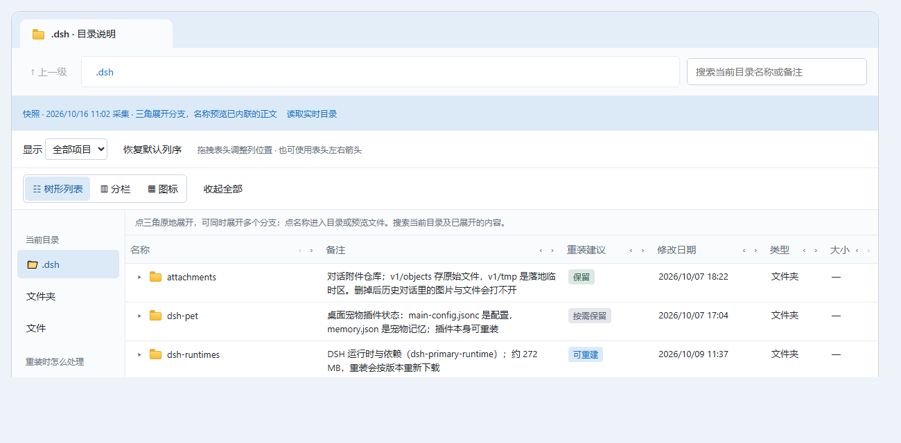
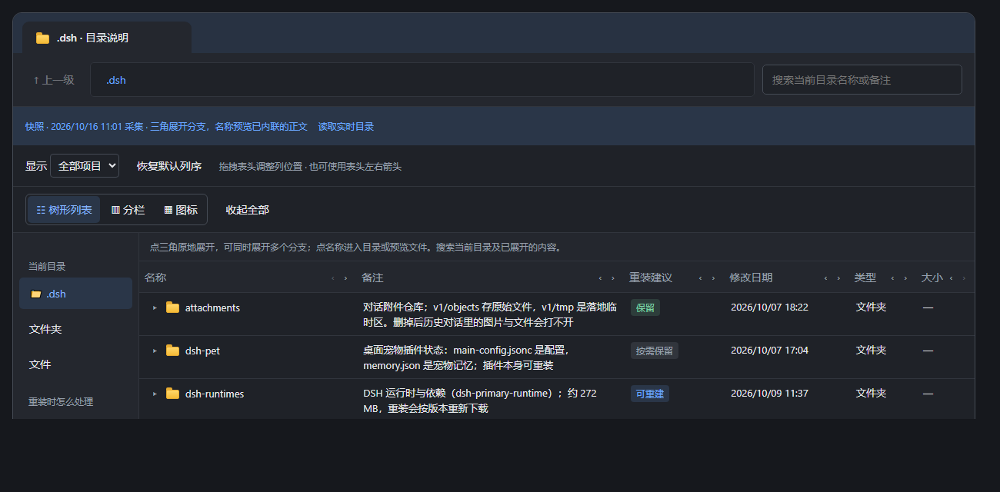

# @free-lzj/dsh-directory-guide

**把 `~/.dsh` 目录说明做成 dsh 的一个一级面板：侧边栏点一下，看清每一项是什么、重装时该不该留、以及小文本文件里写了什么。**

装好后侧边栏的全局面板列表里多一个文件夹图标，排在 **Plugins（0）→ 自动化任务（10）→ 上下文洞察（20）→ 本插件（30）**，点开就是完整的目录说明页。



## 它回答什么

| 列 | 说明 |
|---|---|
| **名称** | `~/.dsh` 的目录树，三角就地展开、名称进入目录或预览文件 |
| **备注** | 每项的实际用途；`sessions` / `profiles` / `storages` 这类丢不起的写清楚代价，SQLite 边车文件写明「必须跟主库一起处理」 |
| **重装建议** | `保留` / `可重建` / `需核对` / `按需保留` / `随主库`，可当筛选器用 |
| **修改日期 / 类型 / 大小** | 每层实时读取，不是写死的快照 |

三种视图（树形 / 分栏 / 图标）、表头拖拽换列、按名称与备注搜索、列宽记忆（存在浏览器 localStorage，不上传）。

## 主题跟随

面板跟随 DSH 当前主题 —— 包括第三方主题，因为它们改的是同一批 token。DSH 把主题 token 写成 **`body` 上的内联 CSS 变量**（`ui-layout` 的 theme-presenter），面板又是**同源 iframe**，所以桥直接读宿主文档的 computed style 就够了，不需要任何消息通道：

- 12 个 `--dsw-alias-*` token → 面板自己的 `--guide-*`（页面背景、两层表面、主/次文字、两级描边、强调色、成功/警告/错误/闲置四态）
- 其余颜色（hover、选中、标题栏、徽章底色）用 `color-mix()` 从这些基色派生，所以换了 token 就整体跟着变
- 一个 `MutationObserver` 盯住宿主 `body` 的内联变量与 `data-ds-dark-theme`，改主题**即时生效**，不用重开面板
- 读不到宿主时（离线单开 `dsh-directory-guide.html`）退回内置的浅/深两套配色，深色由 `prefers-color-scheme` 决定



文件夹/文件图标那几笔黄色是刻意留的「对象色」，深浅两套主题下都照旧。

## 数据边界

浏览器文档够不到文件系统，所以扫描全部发生在 Host 半边：

- **深度** `~/.dsh` 往下两层（顶层 → 子目录 → 再一层），再深只列名不展开
- **体积** 单目录最多列 400 项，超过显示「…另有 N 项未列出」
- **正文** 只内联 **≤ 64 KiB 的文本文件**（md / yml / json / jsonc / py / ts / log 等），更大的、二进制的只说明原因
- **凭据** `.credentials.yaml` 这类文件**整个不读**，正文一律不给；其余文本在 **Host 侧**先脱敏（`token` / `password` / `api_key` / `authorization` 等键的值，以及 `sk-…`、JWT、URL 里的 `user:pw@`）再进响应 —— 值根本没离开过进程，页面也就无从泄露
- **不展开** `electron`、`dsh-runtimes`、任何 `node_modules`、`attachments/v1/objects`：几百 MB 的二进制或 vendored 包，列个名字就够了
- 两条路由都带 `no-store` 与同源校验（`Sec-Fetch-Site` + `Origin`），面板文档由 Host 下发 CSP：`connect-src 'self'`，只允许它读自己那一份快照

数字是刻意留的旋钮：想看得更深就调 `src/snapshot.ts` 的 `MAX_DEPTH` / `TEXT_LIMIT` / `MAX_CHILDREN`。

## 安装

```sh
dsh plugin --profile web add @free-lzj/dsh-directory-guide
```

桌面端用 `--profile desktop`。作为 bundle 安装时 `dsh.bundle` 会让 `dsh plugin add` 自动插入那一条 Loader 行（`cordis.patch.yml`），不需要手工声明。

<details>
<summary>从本仓库安装（改插件本身时才需要）</summary>

```sh
pnpm install
pnpm --filter @free-lzj/dsh-directory-guide run build

dsh plugin --profile desktop add "<本仓库绝对路径>/packages/directory-guide"
```

</details>

## 两块半边

| 半边 | 文件 | 负责 |
|---|---|---|
| Host | `src/index.ts`、`src/snapshot.ts`、`src/notes.ts` | 走 `~/.dsh`、脱敏、在 `/dsh-directory-guide/snapshot` 给数据、在 `/dsh-directory-guide/panel` 给文档 |
| 浏览器 | `src/client/*` | 注册 `sidebar.panellist` 图标与 `main` 面板；面板本身是 iframe 里的 `assets/panel.html` |

面板做成自带样式的文档而不是 React 组件树：它是一个树 + 三种布局 + 可拖拽列 + 预览对话框，用文档写一百行，用组件树要一千行。iframe 也顺带把它的样式和 `dialog` 挡在 shell 之外。

## 开发

```sh
pnpm --filter @free-lzj/dsh-directory-guide run typecheck
pnpm --filter @free-lzj/dsh-directory-guide run build
pnpm exec vitest run packages/directory-guide
```

`tests/snapshot.spec.ts` 用临时目录驱动真实扫描（深度、脱敏、凭据、体积、二进制），`tests/panel.client.spec.ts` 在 jsdom 里把**真正的** `assets/panel.html` 喂给**真正的** Host 响应，检查两边契约 —— 包括读失败时页面报告错误而不是渲染空表。

## 已知限制

- 面板是快照，不是文件监视器：每次打开面板读一次，页面上写着采集时间。没有缓存，因为「这里到底有什么」答错比答慢更糟。
- 「读取实时目录」按钮走浏览器 File System Access API，只在你用 Chrome / Edge 直接打开仓库根的 `dsh-directory-guide.html` 离线版时可用；面板嵌在 GUI 里时该按钮会说明它拿不到本地目录权限（快照模式本来就够用）。
- 扫描是同步的 `readdirSync` / `readFileSync`：几百个目录项 + 二十来个文本文件，实测几十毫秒。真变慢了再上异步或 TTL 缓存。
